# Printing IoT — Operator Manual (v4.0)

> **Version**: v4.0 · 2026-11-15. Rewritten from the **actual program behavior and real screenshots**, replacing the earlier v2.x text.
> **Screenshots**: Orders starting with `SIM` in the report and analysis screenshots are **simulated test data** (October 2026), not real production records.
> **Scope**: the main system. Maintenance and parts management moved to the separate **MM plug-in** (see section 10).
> The Traditional Chinese edition is `操作說明書.md`; this document follows the same structure.

---

## Contents

1. [Login and shift](#1-login-and-shift)
2. [Screen layout](#2-screen-layout)
3. [Monitor](#3-monitor)
4. [Schedule](#4-schedule)
5. [Reports](#5-reports)
6. [Analysis](#6-analysis)
7. [Settings (administrators)](#7-settings-administrators)
8. [Documents page](#8-documents-page)
9. [Troubleshooting](#9-troubleshooting)
10. [Appendix](#10-appendix)

---

## 1. Login and shift

Opening the system (default `http://localhost:5600`) shows the **login window**. Choose a shift and an operator to enter.

")

| Area | Description |
|---|---|
| **Admin** (top left) | For administrators, engineers and supervisors. The password field appears only after pressing it |
| **Select** (top right) | Confirms the login. Operators press this after choosing an account |
| **Exit** | Closes the login window |
| **Current Shift** drop-down | The shift you are working (e.g. Day 08:00~18:00) |
| **Username** | The operator account. Selecting a roster row fills it in |
| Roster table | Quick list of operators for this machine. Click a row to fill in the account; the **+** row adds an entry |
| Shift table | Start/end times and head count per shift |

### Operator login (two actions)

1. **Click a roster row** (or type the account, e.g. `OP1`, into *Username*).
2. Press **Select**. **No password is required.**

> **ℹ** The operator password is supplied automatically. Operator accounts can run the shop floor but **cannot change settings**.

### Administrator / engineer / supervisor login

1. Press **Admin**: a **Password** field appears and the top-left button becomes **Back** (returns to operator mode). 2. Enter account and password (12 letters/digits). 3. Press **Select**.

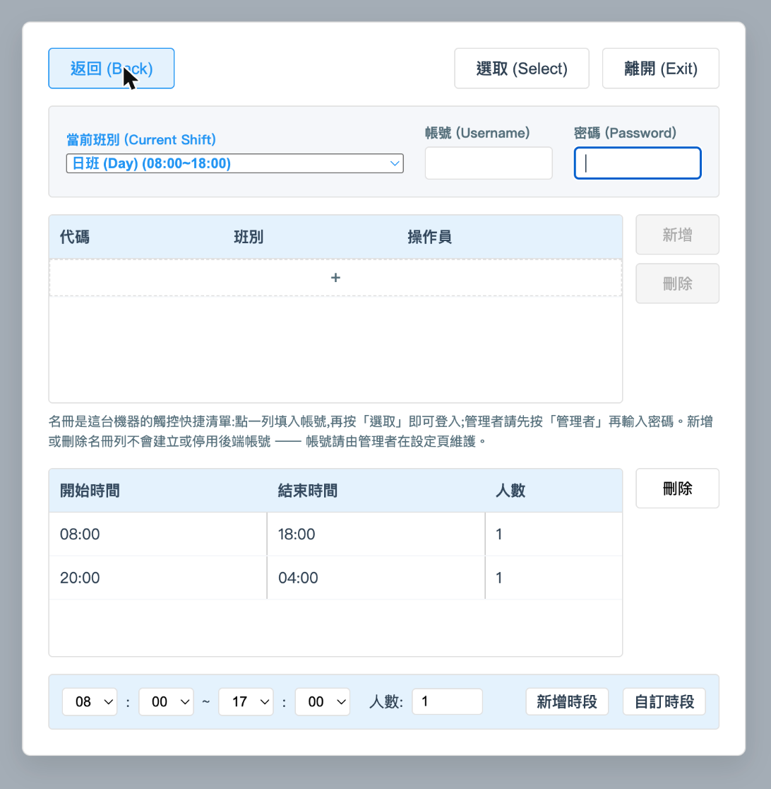

### What happens behind the login

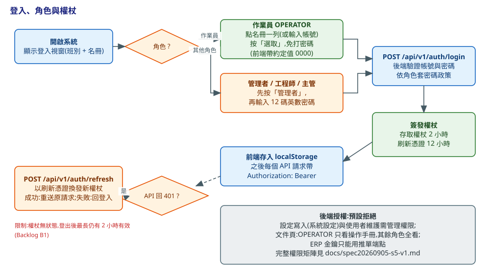

- After login the server issues an **access token (2 hours)** and a **refresh token (12 hours)**.
- When the access token expires the system **renews it automatically**; you are only sent back to the login window if renewal fails.
- The shift is recorded on every production report row — **make sure it is correct**.

> **⚠** Roster changes do **not** create or disable server accounts. Accounts are maintained by an administrator in *Settings → General*.

---

## 2. Screen layout

Every page shares the same frame. Example: the Monitor page.

")

### Top bar

| Item | Description |
|---|---|
| **Monitor** | Default home page |
| **Schedule** | Order queue and product library |
| **Reports** | Details, daily, monthly, stop reasons |
| **Analysis** | Charts by condition |
| **Settings** | System settings (some tabs are administrator-only) |
| **Documents** | Built-in documents (this manual) |
| **Language** | Switch language |
| Top right | Help window, language drop-down, current user and **Logout**, connection status |

### Language

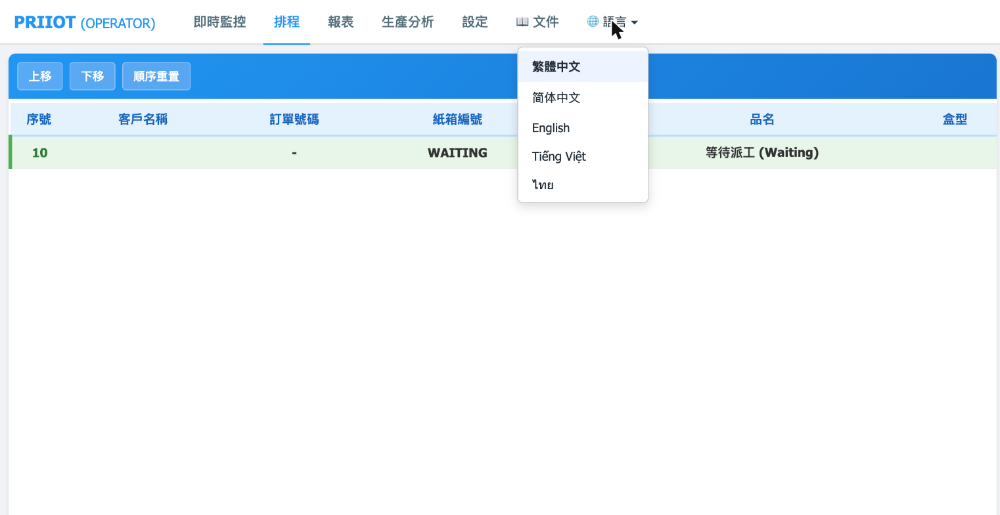

**5 languages**: 繁體中文, 简体中文, English, Tiếng Việt, ไทย. The change is immediate and remembered.

### Function-key bar and status bar

The bottom row of buttons mirrors the keyboard **F keys** (section 3). **F keys work only on the Monitor page.**
The status line shows machine state, **PLC / ERP** connection lights (green = connected), a fixed layout text "Start Time" (not live data), and the current operator, shift and role.

---

## 3. Monitor

The page operators use most: **start an order, watch production, log stops, finish**.

### 3.1 Screen areas (Figure 2-1)

| Area | Content |
|---|---|
| **QTY** (top left, large) | Count of the current order / target (percent). The number is *count − zero offset*; it restarts from 0 when you press F3 |
| **Speed** (top right, large) | Current speed in sheets/min, with reference values "Standard 280" and "Max 350" |
| **Summary table** | Two rows, **Today** and **This order**: area, total, counted, remaining, defects, average speed, run time, stop time, stops |
| **Green status box** | "Idle" when nothing is running; shows the running order otherwise |
| **Queue** (lower left) | No., customer, order no., box no., quantity, product name, box type |
| **Machine status** (right) | Two tabs: **Machine status** (feeder, colors 1–4, slotter, folder-gluer, counter: RUN / ERR / OFF) and **Stop reasons** |
| Header "Auto Next ON" | Current auto-next mode (toggle with F8) |

### 3.2 Function keys

| Key | Name | Actual behavior | Precondition |
|---|---|---|---|
| **F1** | Up | Move the selected queue order up one row | — |
| **F2** | Down | Move the selected queue order down one row | — |
| **F3** | Send | Move the **selected queued order** into the green box and start; count and this-order run/stop times reset to 0; the server "current order" is updated | **PLC must be connected** (otherwise blocked with a message); green box empty and a queued order selected |
| **F4** | Finish | Opens the **finish dialog**; submitting writes to reports | **Speed must be 0** and **count > 0** |
| **F5** | Good +1 | Manually add 1 to the count (correction) | — |
| **F6** | Defect −1 | Manually subtract 1 from the count (correction) | — |
| **F7** | Order | Opens the order detail window | — |
| **F8** (labelled M/N Next) | Auto/manual next | Toggles *Auto Next* | — |
| **F9** | Shift | Reopens the login window to change shift | — |
| **F10** | Return | Returns the running order to the queue; count resets; the server current order is cleared | **Speed must be 0** |
| **F12** | Exit | Leaves the system | The browser shows a confirmation window |

> **⚠ Common misunderstanding**: **F3 does not require the machine to be stopped** — it requires a **PLC connection**. **F4 and F10** are the keys that require speed 0.
>
> **ℹ Auto Next (F8)** affects only **F10**: ON swaps the returned order with the next queued one; OFF leaves the green box empty.

### 3.3 Standard workflow

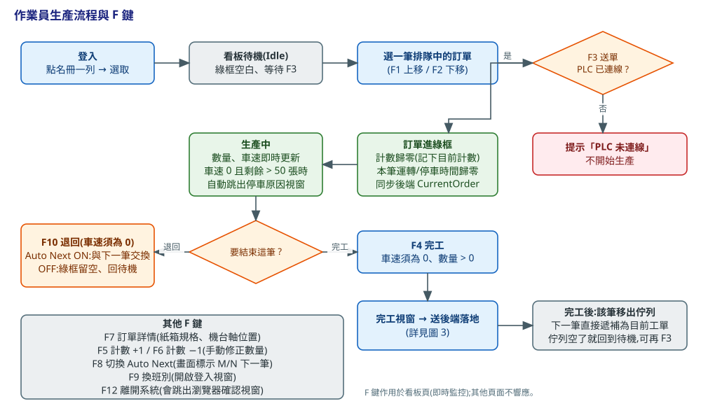

1. Log in and choose the shift.
2. Use **F1 / F2** to select and order the queue.
3. Check the PLC light is green, then press **F3**. The count starts from 0.
4. **While running**, watch count and speed. When **speed drops to 0 and more than 50 sheets remain**, the **stop-reason window opens automatically** (3.6).
5. When the target is reached, **stop the machine** and press **F4**; complete the dialog (3.4).
6. **After finishing, the order leaves the queue and the next order becomes the current one.** If the queue is empty the page returns to idle.

### 3.4 What F4 does

 to saved result")

Fill in **good quantity**, **defect details** (by defect reason) and the **shortage reason** when good is below target. After confirming:

1. The result is first **saved locally** (`pending`); the shop floor **never waits for the server**.
2. In the background it is **sent to the server**, which **recomputes** the defect total, stop count, **factory day** and the four **OEE values**, and marks the order *Completed*.
3. Success: the local record becomes `synced` and takes the server's numbers.
4. Failure (network down, rate limit, server busy, expired token): **3 automatic retries** (about 2 s, 8 s, 30 s). Errors that retrying cannot fix (invalid fields, no permission) are **not retried**.
5. Still failing: the record **stays local** and does not block the next order. Use the **Local record backfill** panel on the Reports page later.

> **ℹ No duplicates**: every result carries a unique ID, so re-sending is safe.

### 3.5 Order detail window (F7)

")

The upper form holds carton no., customer, product name, box type, flute, thickness, sheet count and remarks (editable; **OK** saves). The lower-left frame shows the carton layout; the right side lists the machine axis positions (PX1–PX5, feed gaps, slotter, etc.); the **Printing** table lists impression, position, belt gap and plate gap for colors 1–4.

### 3.6 Stop-reason window

When speed is 0, there is production, and more than 50 sheets remain, the window **opens automatically** and the right panel switches to **Stop reasons**. Choose a reason (feed skew, unclear print, paper break, ink shortage, machine fault, other); the **start time and duration** are recorded and sent with the finished order.

### 3.7 Where the live data comes from

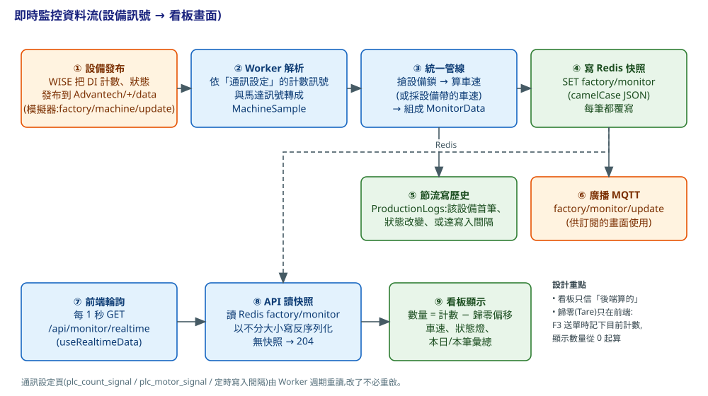

The page reads the latest snapshot from the server **every 1 second**. Count, speed and status come from **device signals sent over MQTT**; the green "PLC" light means signals are arriving.

---

## 4. Schedule

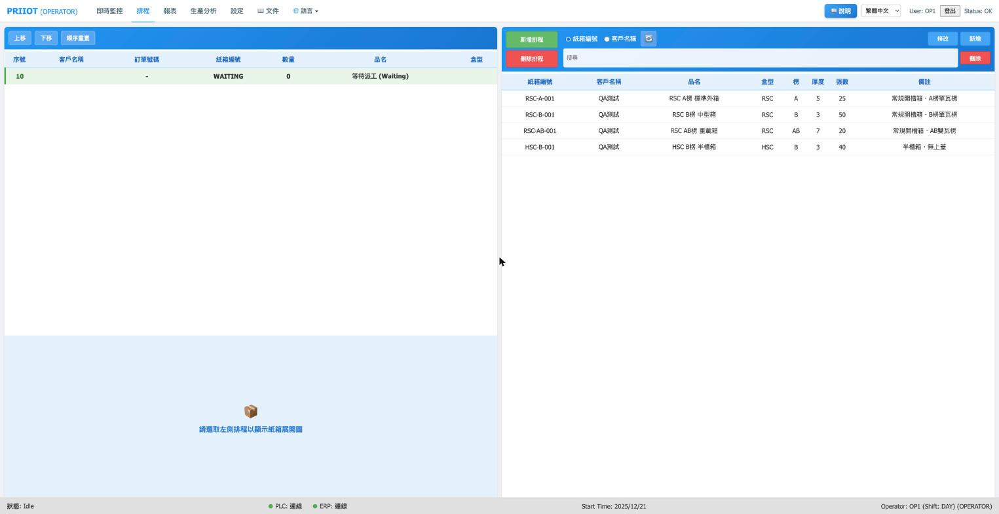

| Area | Description |
|---|---|
| **Left: queue** | No., customer, order no., box no., quantity, product name, box type. Shows "Waiting" when empty |
| Up / Down / **Reorder** | Move the selected order; **Reorder** renumbers the sequence as 10, 20, 30… (a browser confirmation appears first) |
| Queue table | Rows can be **dragged** to reorder; the **running order is locked** |
| Lower left | Carton layout preview of the selected order |
| **Right: product library** | Box no., customer, product name, box type, flute, thickness, sheets, remarks |
| Search + radio (box no. / customer) | Choose the search field |
| **Add schedule** / **Delete schedule** | Add the selected product to the queue / remove the selected queue order |
| Edit / Add / Delete | Maintain product records |

**Steps**: find the product → **Add schedule** → enter the quantity → adjust order with Up/Down or drag → press **F3** on the Monitor page.

> **ℹ** **Queued orders** are synchronized to the server. The **product library is stored only in this browser**.

---

## 5. Reports

The left menu has **4 reports**: Details, Daily, Monthly, Stop reasons.

> **ℹ** A label **"Totals computed by the server"** means normal operation. "Computed locally" means unsynchronized local records exist or the server is unreachable; numbers may differ from the server.

### 5.1 Details

")

Set the date range and press **Confirm**. Columns: no., customer, order no., product, shift, speed, quantity, counted, good, defect, finish time, OEE, source ("Server" = stored on the server).

Click a row (its box is ticked) to list that order's **stops** below: start time, duration and reason.

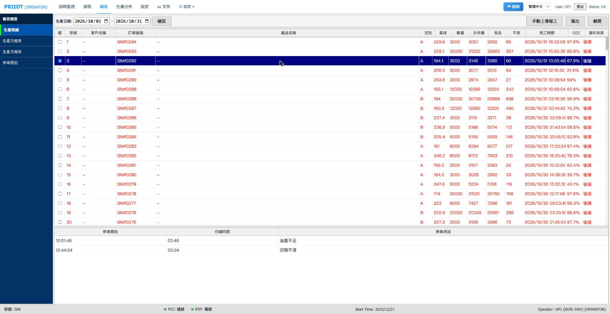

### 5.2 Daily report

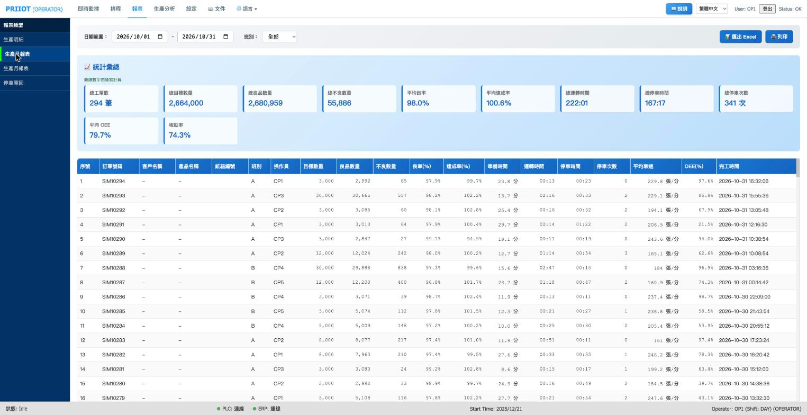

Filters: date range and shift. **Export Excel** / **Print**. The blue **summary cards**: total orders, total target, total good, total defect, average yield, average achievement, total run time, total stop time, stop count, **average OEE** and **utilization**. Below is one row per order.

### 5.3 Monthly report

")

Choose year and month. One row per **production day**: date, orders, output, good, defect, yield, average speed, run time, stop time, utilization; the bottom row is the **monthly total**. Days without production do not appear. Unusual days stand out — here 10/21 shows only 6 orders and 19.8% utilization.

### 5.4 Stop reasons

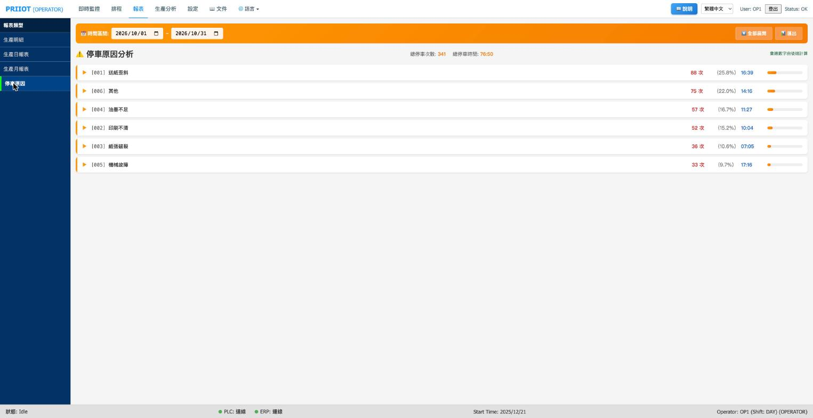

Choose the period. Reasons are listed by **count, descending** with code and name, count, share, total duration and a bar. The top shows **total stops** and **total stop time**. **▶** expands a reason; **Expand all / Collapse all** switch everything at once.

### 5.5 How the numbers are computed

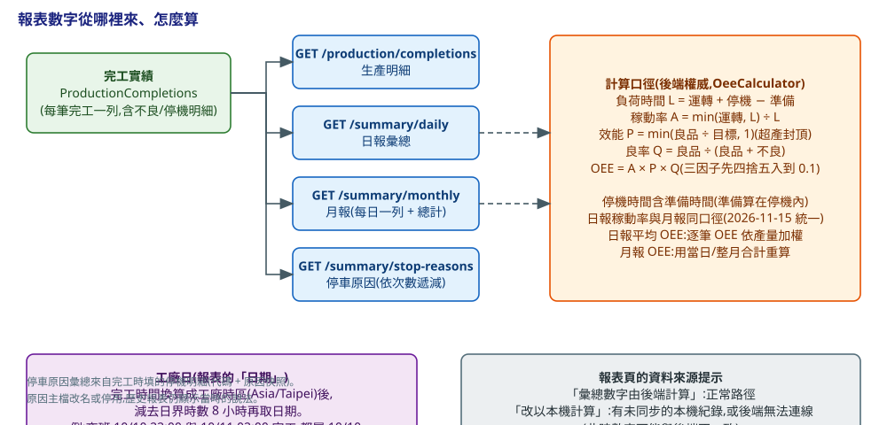

| Metric | Formula |
|---|---|
| Load time L | run + stop − preparation |
| **Utilization** | min(run, L) ÷ L — **same basis in daily and monthly reports** |
| Performance | min(good ÷ target, 1) |
| Yield | good ÷ (good + defect) |
| **OEE** | utilization × performance × yield |
| Daily "average OEE" | per-order OEE **weighted by output** |
| Monthly OEE | recomputed from the **combined totals** |

> The daily average OEE and the monthly OEE can differ — by design. **Utilization** is identical. **Stop time includes preparation time.**
>
> **Factory day**: report dates use the **factory day**, which changes at **08:00**. Orders finished on a night shift at 22:00 and at 02:00 the next calendar day both belong to the same factory day.

### 5.6 Local record backfill

If results stayed local (`pending`), the Reports page shows a **backfill panel**: **scan** first (read-only), then **backfill**. It can be repeated; existing records are not duplicated.

---

## 6. Analysis

")

**Left controls**: date range (with Today / Yesterday / Last 7 days / This month), **grouping conditions**, **display fields** (default *Quantity*), **chart type** (pie, donut, line, bar, radar), **time scale** (minute, hour, day, week, month), **Export Excel**, **Download image**, **Print**, **Clear conditions**.

**Right side**: **Chart** and **Table** tabs; five KPI cards (total good, daily average, total stop time, average speed, number of records); the chart below, with **◀ Start / End ▶** to move the range.

---

## 7. Settings (administrators)

The left menu has **7 categories**: **General** (company header, user accounts, shifts, stop and defect reasons), **Unit**, **Machine**, **Formula**, **Communication**, **Box type**, **Report**. Categories you may not use show *Access Denied*.

> **ℹ** The category menu at the top left ("Settings / General / Unit…") currently has **no styling** and appears as small text, but **clicking works**. Operators can **open** most tabs, but **saving needs the matching permission**; blocks such as user maintenance show a read-only notice.

### 7.1 General

")

**Company header** (names, address, phone, fax, logo — printed on reports); **User settings** (accounts; **only a system administrator can edit**, others see a read-only notice); **Shift times** (e.g. Day 08:00~18:00, Night 20:00~04:00); **Stop reasons** and **Defect reasons** further down — shop-floor dialogs and reports share this list.

### 7.2 Machine

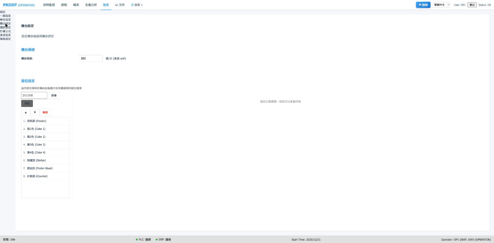

**Machine max speed** (sheets/min; the Monitor "Max" reference comes from here) and **Section settings** (feeder, colors 1–4, slotter, folder-gluer, counter; add, reorder, delete). The sections appear in the Monitor **Machine status** tab.

### 7.3 Formula

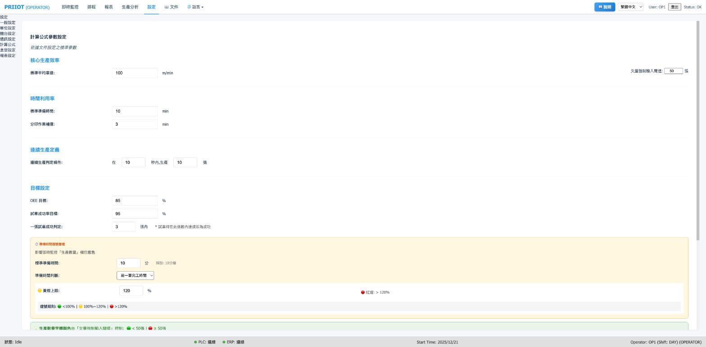

**Core efficiency** (standard average speed; **shortage-input threshold**, default 50 sheets — it colors the Monitor QTY text: green when remaining is below the threshold, red otherwise. The Monitor's automatic stop-reason window uses a **built-in** "more than 50 sheets remain" rule that this setting does not change); **Time utilization** (standard preparation time); **Continuous production** (N seconds / M sheets); **Targets** (OEE target, trial-run targets); **Preparation-time signal** — colors the Monitor QTY field: green (< 100%), yellow (100%~120%), red (> 120%).

### 7.4 Other categories

**Unit** (metric mm or inch, plus a template table), **Box type**, **Report**: simple pages; follow the on-screen fields.

### 7.5 Communication settings

")

From top to bottom: **PLC control** (green "Connected (Motor On)" tag = device signals arriving; **enable switch**, "Simulate signal", device type, protocol, MQTT broker/topic, monitoring interval, **Test Connection**, **Monitor messages**); **ERP integration** (switch, protocol, connection and paths); **Data logging** (write interval in seconds).

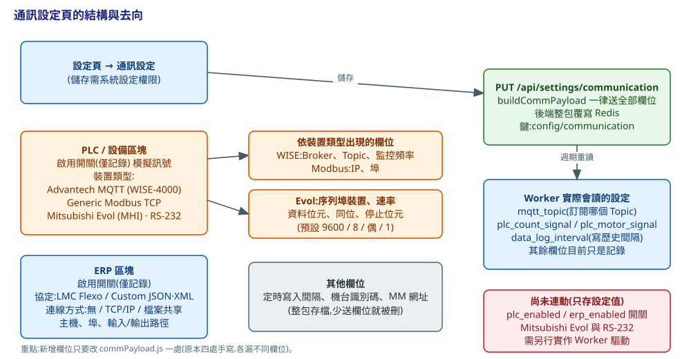

**PLC / device block**

- **Enable switch**: records whether the channel is enabled. **It currently stores the setting only and is not yet connected to the real connection** (a grey note says so).
- **Device type**: **Advantech MQTT (Wise-4000)** — protocol "MQTT · Advantech WISE-4000", with MQTT broker URL, topic (default `Advantech/+/data`) and monitoring interval; **Generic Modbus TCP** — IP and port; **Mitsubishi Evol (MHI)** — protocol "Mitsubishi Evol (MHI) · RS-232", with serial port, baud rate (default 9600), data bits (8), parity (even) and stop bits (1). **Evol currently stores settings only; no driver connects yet.**

**ERP block**: enable switch (record only), protocol (LMC Flexo / custom JSON·XML), connection (none / TCP/IP / file share).

Other fields: **data-log interval** (seconds, 1–3600, default 300), **machine ID**, **MM URL**.

> **⚠** The whole configuration is saved as one unit; the system always sends **all fields** so nothing is wiped.

---

## 8. Documents page

Click **Documents** in the top bar. Documents are grouped by category. **Operators see only the operator manuals** (Chinese and English); administrators, engineers and supervisors see everything. Documents support **images, tables and diagrams**; click an image to open it full-size.

---

## 9. Troubleshooting

| Symptom | Likely cause | Action |
|---|---|---|
| F3 does nothing, "PLC disconnected" | No device signal | Check the PLC light; check the device and network |
| F4 says speed is not 0 | Machine still running | Stop the machine completely |
| F4 says quantity is 0 | Nothing produced for this order | Use **F10 Return** instead |
| F10 says speed is not 0 | Machine still running | Stop it first |
| Speed shows 0 while running | Signal not arriving | Check the status line; ask maintenance |
| Report is empty | No data in range; default range is *today* | Set the range and press **Confirm** |
| "Computed locally" | Unsynchronized local records or server unreachable | Run the backfill panel or retry later |
| Daily and monthly OEE differ | Different methods | By design; utilization matches |
| Blank page | Browser cached an old version | Hard refresh (`Ctrl+F5` / `Cmd+Shift+R`) |
| Logged out after a while | Both tokens expired | Log in again |
| F keys do nothing | Not on Monitor page, or focus is in an input | Return to Monitor and click an empty area |

---

## 10. Appendix

### F-key quick reference

| Key | Function | Key | Function |
|---|---|---|---|
| F1 | Up | F7 | Order detail |
| F2 | Down | F8 | Auto/manual next |
| F3 | Send (needs PLC) | F9 | Change shift |
| F4 | Finish (speed 0, count > 0) | F10 | Return (speed 0) |
| F5 | Count +1 | F12 | Exit |
| F6 | Count −1 | | |

### Maintenance and parts

**Maintenance** and **parts management** moved out of the main system in June 2026 to the separate **MM asset-management plug-in** (local entry `http://localhost:5301`).

### System overview

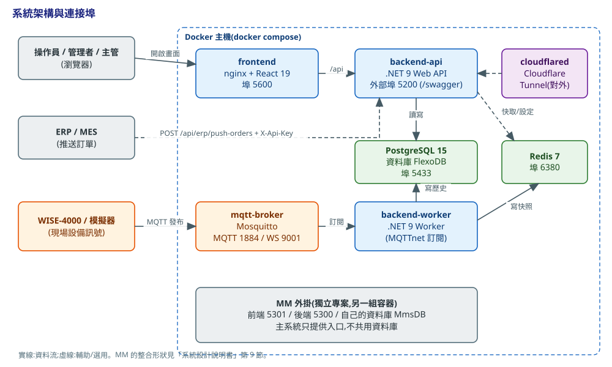
