# 印刷 IoT 系統操作說明書

## Printing IoT — Operator's Guide(v4.0)

> **版本**:v4.0 · 2026-11-15。依**實際程式行為與實機畫面**重寫,取代 v2.x 內容。
> **圖文說明**:每個畫面都附實機截圖,並以區塊對照說明;操作與資料如何流動則以流程圖呈現。
> **截圖資料**:報表、分析畫面中的 `SIM` 開頭訂單是**測試用模擬資料**(2026 年 10 月),不是真實生產紀錄。
> **範圍**:本文件說明主系統。保養維修與零件管理已移到獨立的 **MM 外掛**,不在本文件範圍(見第 10 章)。
> **另有 v3.0 定稿(HTML)**:`操作說明文件.html` 含 MM 與全部畫面線框,可並用。

---

## 目錄

1. [登入與班別](#1-登入與班別)
2. [畫面總覽:導覽列、功能鍵列、狀態列](#2-畫面總覽導覽列功能鍵列狀態列)
3. [即時監控(Monitor)](#3-即時監控monitor)
4. [生產排程(Schedule)](#4-生產排程schedule)
5. [生產報表(Report)](#5-生產報表report)
6. [生產分析(Analysis)](#6-生產分析analysis)
7. [系統設定(Settings,管理者)](#7-系統設定settings管理者)
8. [文件頁](#8-文件頁)
9. [故障排除](#9-故障排除)
10. [附錄](#10-附錄)

---

## 1. 登入與班別

開啟系統(預設 `http://localhost:5600`)會先看到**登入視窗**,選好班別與操作員才能進入系統。

")

### 畫面區塊

| 區塊 | 說明 |
|---|---|
| 左上「管理者 (Admin)」 | 管理者、工程師、主管登入用。按下後才會出現密碼欄 |
| 右上「選取 (Select)」 | 確認登入。作業員選好帳號後按這顆 |
| 右上「離開 (Exit)」 | 關閉登入視窗 |
| 「當前班別」下拉 | 選這次上工的班別(例:日班 08:00~18:00) |
| 「帳號 (Username)」欄 | 作業員帳號。點名冊任一列會自動帶入 |
| 點名冊表格 | 這台機器常用的作業員快捷清單。點一列填入帳號;最下方的「+」可就地新增一列 |
| 班別時段表 | 下方表格,列出班別的起訖時間與人數;可新增或自訂時段 |

### 作業員怎麼登入(兩個動作)

1. 在點名冊**點選一列**(或在「帳號」欄直接輸入帳號,例如 `OP1`)。
2. 按「**選取**」。**不需要輸入密碼。**

> **ℹ 為什麼不用密碼?** 作業員帳號的密碼由系統帶入約定值,現場不必每次輸入;但**這個帳號只能操作現場功能**,不能改設定。

### 管理者、工程師、主管怎麼登入

1. 按左上「**管理者 (Admin)**」。
2. 輸入帳號與密碼(12 碼英數)。
3. 按「選取」。

### 登入背後發生什麼事

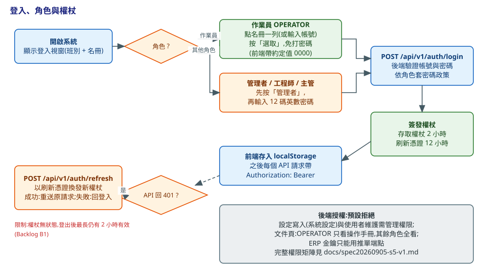

- 登入成功後,後端簽發**存取權杖(2 小時)**與**刷新憑證(12 小時)**。
- 存取權杖到期時,系統會**自動換發**,作業員不會被打斷;若連換發都失敗,才會回到登入視窗。
- 班別資訊會記錄在每一筆生產報表裡,**請確認選對班別**。

> **⚠ 注意**:名冊是「這台機器的快捷清單」,新增或刪除名冊列**不會**建立或停用後端帳號。帳號請由管理者在設定頁的「一般」分頁維護。

---

## 2. 畫面總覽:導覽列、功能鍵列、狀態列

登入後,所有頁面共用同一個外框。以下以「即時監控」為例:

")

### 上方導覽列

| 項目 | 說明 |
|---|---|
| **即時監控** | 預設首頁,監看目前生產 |
| **排程** | 管理待生產的訂單與產品庫 |
| **報表** | 生產明細、日報、月報、停車原因 |
| **生產分析** | 依條件做圖表分析 |
| **設定** | 系統設定(部分分頁僅管理者可見) |
| **📖 文件** | 內建文件頁(本說明書就在這裡) |
| **🌐 語言** | 切換介面語言,見下 |
| 右上「說明」 | 開啟線上操作說明視窗 |
| 右上語言下拉 | 同樣可切換語言 |
| 「User: OP1」「登出」 | 目前登入者與登出鈕 |
| 「Status: OK」 | 與後端的連線狀態 |

### 切換語言

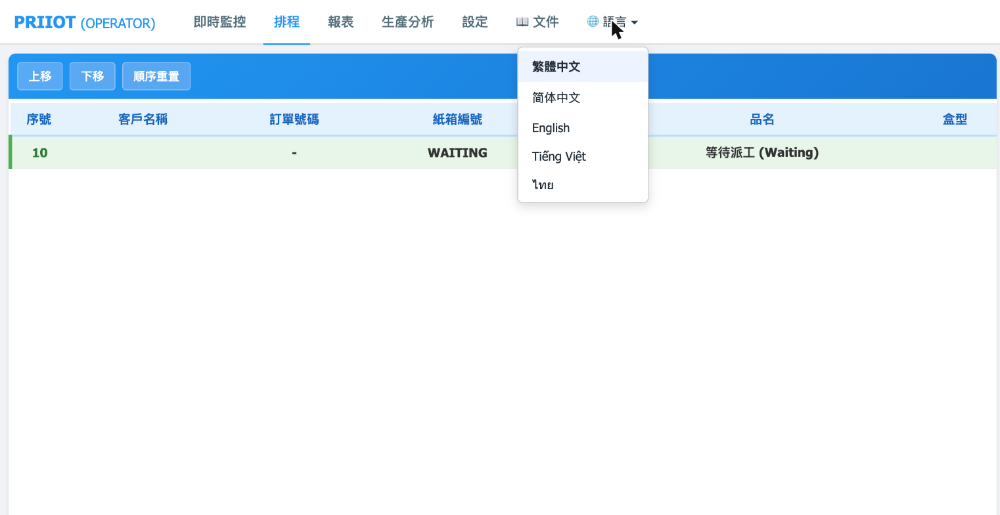

系統支援 **5 種語言**:繁體中文、简体中文、English、Tiếng Việt、ไทย。切換後立即生效,選擇會保留。

### 下方功能鍵列(F 鍵)

畫面最下方一排按鈕對應鍵盤 F 鍵(見第 3 章)。**F 鍵只在「即時監控」頁有作用**,其他頁面按了不會有反應。

### 最下方狀態列

| 位置 | 說明 |
|---|---|
| 左:狀態 | 目前機台狀態(例:Idle 待機) |
| 中:PLC / ERP | 綠點表示連線中 |
| 中右:Start Time | 目前是**固定的版面文字**,不是即時資訊,**不代表實際啟動時間** |
| 右:Operator | 目前操作員、班別與角色 |

---

## 3. 即時監控(Monitor)

操作員最常用的畫面,用來**送單、監看生產、停車登記、完工**。

### 3.1 畫面區塊對照(圖 2-1)

| 區塊(位置) | 內容 | 說明 |
|---|---|---|
| **生產數量 QTY**(左上大字) | 數字 / 目標 (百分比) | 目前這一筆已生產幾張,以及目標與達成率。數字是「計數 − 歸零偏移」,F3 送單時歸零 |
| **車速**(右上大字) | 目前車速 | 單位張/分;旁邊顯示「標準 280」與「極速 350」作為參考 |
| **統計表**(中上) | 兩列:**本日**、**本筆** | 欄位:平方米、總數、計件數、剩餘、不良、平均車速、生產時間、停車時間、停次 |
| **綠色狀態框**(中) | 【待機中 (Idle)】 | 目前沒有生產中的訂單時顯示;生產中會顯示該筆訂單 |
| **排程佇列**(左下) | 序號、客戶名稱、訂單號碼、紙箱編號、數量、品名、盒型 | 排隊待生產的訂單 |
| **機器狀態**(右) | 兩個頁籤:**機器狀態**、**停車原因** | 機器狀態列出送紙部、第 1~4 色、開槽部、摺貼部、計數部的 RUN / ERR / OFF |
| 標題列「自動下一筆 ON」 | 目前的自動下一筆模式 | 以 F8 切換 |

### 3.2 功能鍵(F 鍵)

| 按鍵 | 名稱 | 實際行為 | 前提條件 |
|---|---|---|---|
| **F1** | 上移 | 把選取的排程訂單往上移一格 | — |
| **F2** | 下移 | 把選取的排程訂單往下移一格 | — |
| **F3** | 送單 | 把**選取的排隊訂單**送進綠色狀態框開始生產;計數歸零、本筆運轉/停車時間歸零,並同步後端「目前訂單」 | **PLC 必須連線**(未連線會提示並擋下);綠框要是空的,並先選一筆排隊訂單 |
| **F4** | 完工 | 開啟「完工確認視窗」,送出後寫入報表 | **車速必須為 0**,且**本筆數量大於 0** |
| **F5** | 良品 +1 | 手動把計數加 1(修正用) | — |
| **F6** | 不良 −1 | 手動把計數減 1(修正用) | — |
| **F7** | 訂單 | 開啟「訂單詳情」視窗 | — |
| **F8**(畫面標示 M/N 下一筆) | 切換自動/手動下一筆 | 切換「自動下一筆」 | — |
| **F9** | 班別 | 重新開啟登入視窗以換班 | — |
| **F10** | 退回 | 把目前生產的訂單退回佇列;計數歸零,並清除後端「目前訂單」 | **車速必須為 0** |
| **F12** | 離開 | 離開系統 | 會跳出瀏覽器的確認視窗 |

> **⚠ 常見誤解**:**F3 不需要先停機**,它需要的是 **PLC 連線**。需要「車速為 0」的是 **F4 完工**與 **F10 退回**。

> **ℹ 自動下一筆(F8)** 只影響 **F10 退回**:ON 時,退回的訂單會與佇列下一筆**交換位置**(立即遞補);OFF 時,綠框留空等你重新 F3。

### 3.3 標準作業流程

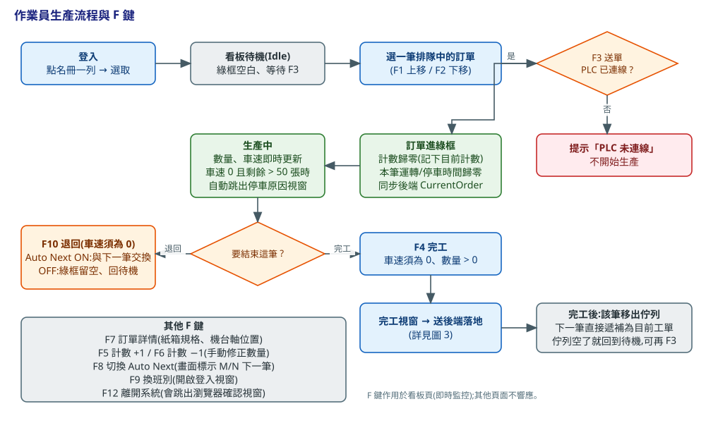

1. 登入並選好班別,進入即時監控。
2. 用 **F1 / F2** 把要先做的訂單選好、排序。
3. 確認 PLC 連線燈為綠色,按 **F3 送單**。數量從 0 開始累計。
4. **生產中**:觀察數量與車速。**車速降到 0 且剩餘張數超過 50** 時,系統會**自動跳出「停車原因」視窗**,請選擇原因(見 3.5)。
5. 達標後**讓機器停下**,按 **F4 完工**,填寫完工確認視窗(見 3.4)。
6. **完工後,該筆訂單移出佇列,下一筆訂單直接遞補為目前訂單**;佇列空了就回到待機。

### 3.4 完工:F4 之後系統做了什麼

到實績落地的流程")

完工視窗請填:

- **良品數量**
- **不良明細**(依不良原因逐項填數量)
- **短缺原因**(實際良品少於目標時)

按確認後:

1. 前端先把這筆**存在本機**(狀態 `pending`),現場**不會停下來等後端**。
2. 在背景把實績**送到後端**。後端會**重算**不良總數、停機次數、**工廠日**與 **OEE 四個率值**,並把工單狀態改為「已完成」。
3. 成功:本機紀錄改為 `synced`,並以後端算的數字覆寫。
4. 失敗(斷網、被限流、伺服器忙、權杖過期):**自動重試 3 次**(約 2 秒、8 秒、30 秒後)。若是欄位錯誤或沒有權限這類「重送也不會變好」的失敗,**不會重試**。
5. 重試仍失敗:這一筆**留在本機**,不影響後續換單。之後到報表頁的「**本機舊實績回填**」面板補送即可(見第 5 章)。

> **ℹ 不會重複**:每筆實績帶有唯一識別(冪等鍵),後端看到同一個識別只會保留一筆。所以「送出了但沒收到回應」再送一次是安全的。

### 3.5 訂單詳情視窗(F7)

:紙箱規格與機台軸位置")

| 區塊 | 說明 |
|---|---|
| 上方表單 | 紙箱編號、客戶名稱、品名、盒型、楞別、厚度、張指數、備註。**可直接編輯,按「確認」後儲存** |
| 左下大框 | 紙箱展開圖。尚未選取訂單時顯示提示:「請選取左側排程以顯示紙箱展開圖」 |
| 右側數值欄 | 機台各軸的設定位置:PX1~PX5、送紙前擋板間隙、送紙輪間隙、開槽導紙輪、開槽部壓線、中刀位置等 |
| 「印刷部」表格 | 1~4 色的印壓、位置、皮帶間隙、版座間隙 |
| 「確認」「取消」 | 儲存或放棄 |

### 3.6 停車原因視窗

車速為 0、已有生產數量、且剩餘超過 50 張時,系統會**自動跳出**停車原因視窗,並切到右側「**停車原因**」頁籤。選擇一個原因(如:送紙歪斜、印刷不清、紙張破裂、油墨不足、機械故障、其他),系統記下**停車起始時間與時長**。完工時這些停機明細會一併寫入報表,成為「停車原因」報表的資料來源。

### 3.7 即時資料從哪裡來

")

看板每 **1 秒**向後端讀一次最新快照。數量、車速、狀態都來自**設備透過 MQTT 送出的訊號**,經後端處理後才顯示;畫面上「PLC: 連線」綠點代表目前有收到設備訊號。

---

## 4. 生產排程(Schedule)

管理**待生產的訂單佇列**與**產品庫**。

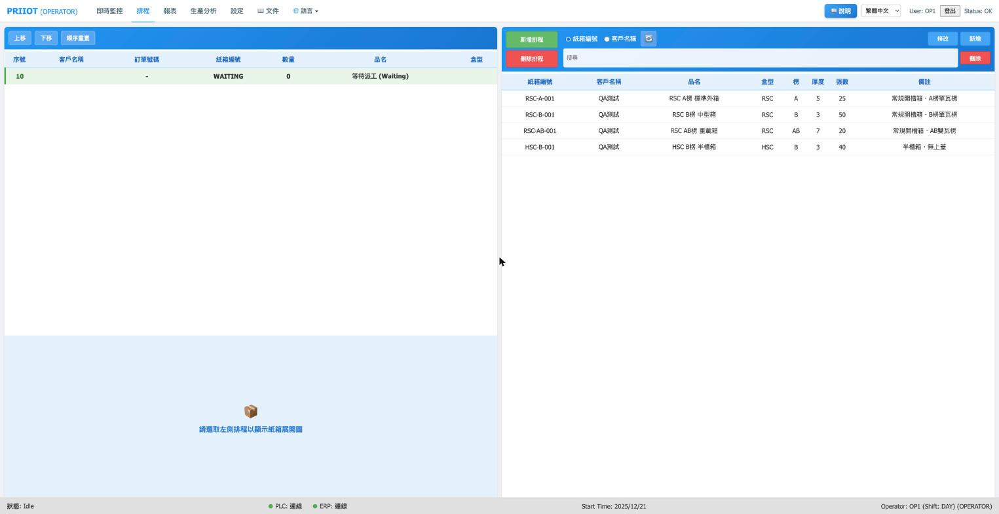

### 畫面區塊

| 區塊 | 說明 |
|---|---|
| **左半:排程佇列** | 欄位:序號、客戶名稱、訂單號碼、紙箱編號、數量、品名、盒型。無訂單時顯示一列「等待派工 (Waiting)」 |
| 左上「上移」「下移」「順序重置」 | 上移 / 下移調整順序(與 F1 / F2 同功能);**順序重置**會把序號重新編為 10、20、30…(按下後會先跳出瀏覽器確認視窗) |
| 佇列表格本身 | 可**拖曳列**調整順序;**執行中的訂單鎖定**,不能拖動 |
| 左下 紙箱展開圖預覽 | 選取左側一筆後,在這裡顯示該紙箱的展開圖 |
| **右半:產品庫** | 欄位:紙箱編號、客戶名稱、品名、盒型、楞、厚度、張數、備註 |
| 搜尋列 + 單選「紙箱編號 / 客戶名稱」 | 決定要用哪個欄位搜尋 |
| 「新增排程」 | 把右側選取的產品排進左側佇列 |
| 「刪除排程」 | 從左側佇列移除選取的訂單 |
| 「修改」「新增」「刪除」 | 維護產品庫的產品資料 |

### 操作步驟

1. 在右側產品庫**找到產品**(用搜尋列)。
2. 選取後按「**新增排程**」,填入數量等資訊,加入佇列。
3. 在左側用「**上移 / 下移**」或**拖曳列**調整順序。
4. 回到「即時監控」,用 **F3** 送單開始生產。

> **ℹ 資料保存位置**:**排程訂單**會同步到後端,換電腦、重新整理都還在;**產品庫目前只存在這台機器的瀏覽器**,換電腦不會跟著走。

---

## 5. 生產報表(Report)

左側選單有 **4 種報表**:生產明細、生產日報表、生產月報表、停車原因。畫面右上的「匯出」「離開」與(部分頁)「手動上傳報工」是共通按鈕。

> **ℹ 資料來源提示**:報表上方會標示「**彙總數字由後端計算**」(正常)。若出現「改以本機計算」,代表有尚未同步的本機紀錄或後端無法連線,**數字可能與後端不一致**,請先處理同步。

### 5.1 生產明細

")

| 項目 | 說明 |
|---|---|
| **生產日期**起迄 + 「確認」 | 設定查詢區間後按「確認」 |
| 表格欄位 | 序號、客戶名稱、訂單號碼、產品名稱、班別、車速、數量、計件數、良品、不良、完工時間、OEE、資料來源 |
| 「資料來源」 | 「後端」= 已存於後端 |
| 「手動上傳報工」 | 手動補一筆報工 |

**看某一筆的停車明細**:點選表格中的一列(左側方框會打勾),**下方**就會列出該筆的**停車開始、持續時間、停車原因**。

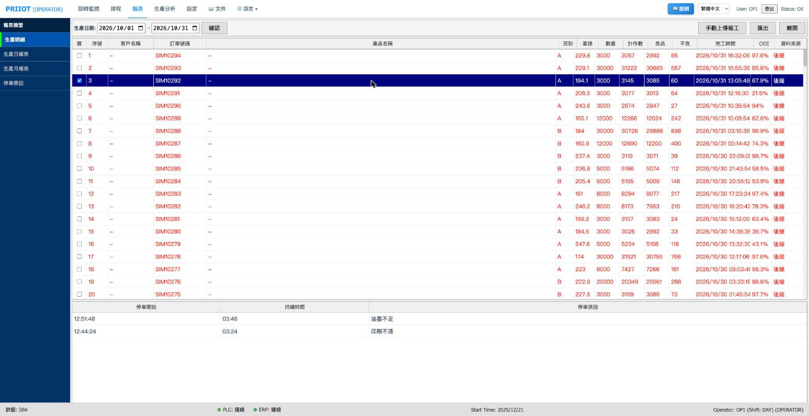

### 5.2 生產日報表

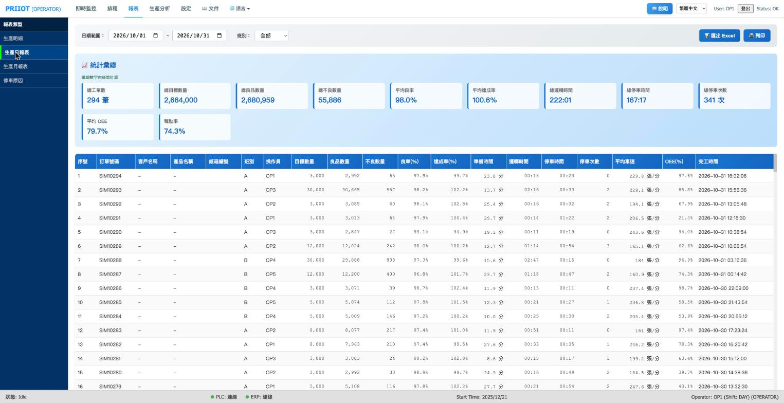

| 區塊 | 說明 |
|---|---|
| 日期範圍、班別 | 篩選條件;「班別」可選全部或單一班別 |
| 「匯出 Excel」「列印」 | 輸出 |
| **統計彙總**(藍色卡片) | 總工單數、總目標數量、總良品數量、總不良數量、平均良率、平均達成率、總運轉時間、總停車時間、總停車次數、**平均 OEE**、**稼動率** |
| 明細表 | 每筆工單一列,含準備時間、運轉時間、停車時間、停車次數、平均車速、OEE |

### 5.3 生產月報表

")

先用上方的「年」「月」下拉選月份。表格**每個生產日一列**:日期、筆數、生產量、良品、不良、良率、平均車速、生產時間、停車時間、稼動率;最下方是**月度總計**。沒有生產的日子(例如週日、休假日)不會出現。

> **看異常日**:上圖 10/21 當天筆數只有 6、稼動率僅 19.8%,明顯低於其他日子,可從這裡一眼找出需要追查的日子。

### 5.4 停車原因

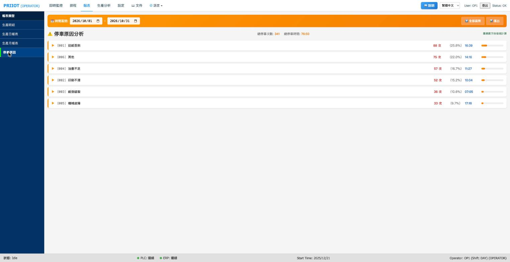

設定「時間區間」後,畫面依**次數由多到少**列出停車原因,每列顯示**代碼與名稱、次數、佔比、總時長**與比例條。上方顯示**總停車次數**與**總停車時間**。按「▶」可展開該原因的明細;「全部展開 / 全部收合」可一次切換。

### 5.5 報表數字怎麼算

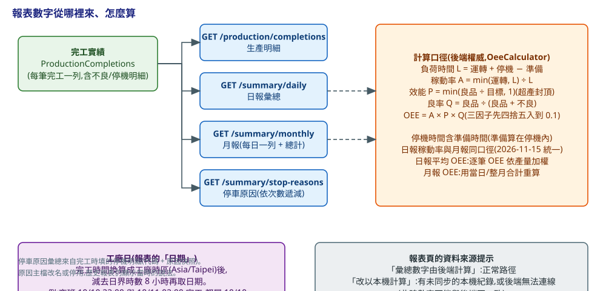

| 指標 | 算法 |
|---|---|
| 負荷時間 L | 運轉 + 停機 − 準備 |
| **稼動率** | min(運轉, L) ÷ L。**日報與月報同一口徑** |
| 效能 | min(良品 ÷ 目標, 1),超產以 100% 封頂 |
| 良率 | 良品 ÷ (良品 + 不良) |
| **OEE** | 稼動率 × 效能 × 良率 |
| 日報的「平均 OEE」 | 逐筆 OEE 依**產量加權**平均 |
| 月報的 OEE | 用當日(或整月)的**合計數據重算** |

> **ℹ 日報的平均 OEE 與月報的 OEE 數字可能不同**:兩者「先平均再算」與「先加總再算」的口徑不同,這是設計如此,不是錯誤。**稼動率**則兩者一致。

**「停機時間」包含準備時間**(準備算在停機裡),所以負荷時間要把準備扣掉。

**工廠日**:報表的「日期」是**工廠日**,以早上 **08:00** 換日。例如夜班 10/10 22:00 與 10/11 02:00 完工的單,都算在 **10/10**。

### 5.6 本機舊實績回填

若有實績因為斷網等原因留在本機(狀態 `pending`),報表頁會出現「**本機舊實績回填**」面板:先**掃描**(只讀、不寫入)確認有哪幾筆,再按**回填**送到後端。可重複執行,已存在的不會重複寫入。

---

## 6. 生產分析(Analysis)

用圖表從不同角度看生產結果。

")

### 左側控制區

| 項目 | 說明 |
|---|---|
| 日期範圍 | 開始/結束日期;快捷鍵「今日」「昨日」「近 7 日」「本月」 |
| 分類條件「+ 新增」 | 加入分類維度(例如依班別、操作員) |
| 顯示欄位「+ 新增」 | 選擇要畫的數值(預設「數量」);按紅色 ✕ 移除 |
| 圖表類型 | 圓餅圖、環圈圖、折線圖、長條圖、雷達圖 |
| 時間刻度 | 分、時、日、週、月 |
| 「匯出 Excel」「下載圖檔」「列印」 | 輸出目前的分析 |
| 「清除條件」 | 還原所有條件 |

### 右側顯示區

- 上方兩個頁籤:**圖表視圖**、**表格視圖**。
- **五張指標卡**:總良品數、日均產量、總停車時間、平均車速、紀錄筆數。
- 下方圖表:標題標示日期區間;滑鼠移到柱上可看數值;右上「◀ 開始」「結束 ▶」可前後捲動範圍。

---

## 7. 系統設定(Settings,管理者)

「設定」頁左側是分類選單,共 **7 個分類**:

| 分類 | 用途 | 誰看得到 |
|---|---|---|
| **一般** | 公司抬頭、使用者帳號維護、班別時間、停車原因與不良原因主檔 | 管理者可維護 |
| **單位** | 單位設定 | 所有登入者 |
| **機台** | 機台各部位(送紙部、印刷色、開槽部…)的設定 | 所有登入者 |
| **公式** | 計算公式 | 有權限者 |
| **通訊** | PLC / 設備、ERP 連線設定,定時寫入間隔,機台識別碼 | 有權限者(需系統設定權限才能儲存) |
| **盒型** | 盒型主檔 | 有權限者 |
| **報表** | 報表相關設定 | 所有登入者 |

> 沒有權限的分類會顯示「Access Denied」。

> **ℹ 畫面說明**:設定頁左上角的分類選單(「設定 / 一般設定 / 單位設定…」)目前**沒有套用樣式**,顯示為小字清單,但**點選功能正常**。作業員可以**開啟**多數分頁檢視,但**儲存需要對應權限**;沒有權限時,使用者維護等區塊會顯示唯讀提示。

### 7.1 一般設定

")

| 區塊 | 說明 |
|---|---|
| **公司抬頭設定** | 公司名稱(中、英)、地址、電話、傳真與公司標誌;用於**報表列印**時的抬頭 |
| **使用者設定** | 使用者帳號維護(使用者、代碼、角色、狀態、操作)。**只有系統管理者可以維護**,其他角色看到橘字提示「目前為唯讀」 |
| **班別時間設定** | 班別名稱與起訖時間(例:日 08:00~18:00、夜 20:00~04:00),可新增、刪除 |
| 停車原因設定、不良原因設定 | 往下捲動可見;維護停機與不良原因主檔,**現場彈窗與報表共用這份清單** |

### 7.2 機台設定

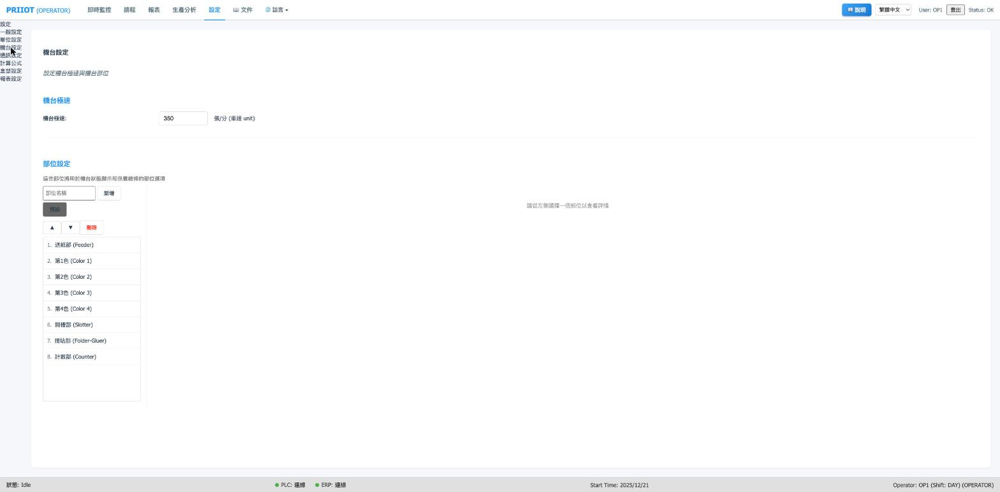

| 區塊 | 說明 |
|---|---|
| **機台極速** | 機台的極速上限(張/分),看板的「極速」參考值取自這裡 |
| **部位設定** | 機台各部位清單(送紙部、第 1~4 色、開槽部、摺貼部、計數部),可新增、上下調整順序、刪除。這些部位會用於看板的**機器狀態**頁籤 |

### 7.3 計算公式

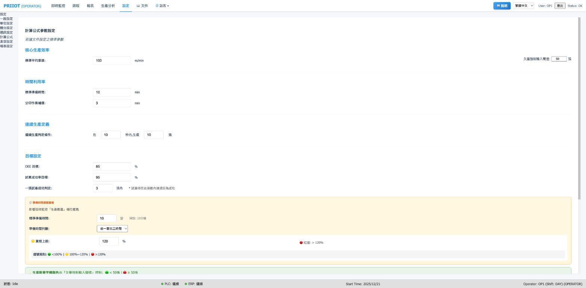

| 區塊 | 說明 |
|---|---|
| **核心生產效率** | 標準平均車速;**欠量強制輸入閾值**(預設 50 張)——控制看板「生產數量」的字體顏色:剩餘小於閾值為綠、大於等於閾值為紅。(看板自動跳出停車原因視窗的條件「剩餘超過 50 張」是**程式內建值**,不受此設定影響) |
| **時間利用率** | 標準準備時間、分印作業補償 |
| **連續生產定義** | 「在 N 秒內生產 M 張」才算連續生產 |
| **目標設定** | OEE 目標、試車成功率目標、一張試車成功判定 |
| **準備時間燈號管理** | 影響看板「生產數量」欄位的底色:綠(< 100%)、黃(100%~120%)、紅(> 120%) |

### 7.4 其他分類

**單位**(單位選擇:公制 mm 或英制 inch,另有模版設定表)、**盒型**(盒型主檔)、**報表**(報表相關設定)。這三個分頁內容單純,請依畫面欄位操作。

### 7.5 通訊設定

")

畫面由上而下:

1. **PLC 控制設定**(淺藍)— 標題旁的綠色標籤「Connected (Motor On)」表示目前有收到設備訊號;右上角的**啟用開關**與「模擬訊號」勾選;「裝置類型」「協定」「MQTT Broker URL」「MQTT Topic」「監控更新頻率」;右側「Test Connection」與「監控訊息」按鈕。
2. **ERP 整合設定**(淺橘)— 啟用開關、通訊協定、連線模式與路徑。
3. **數據記錄設定**(淺綠)— 定時寫入間隔(秒)與說明。

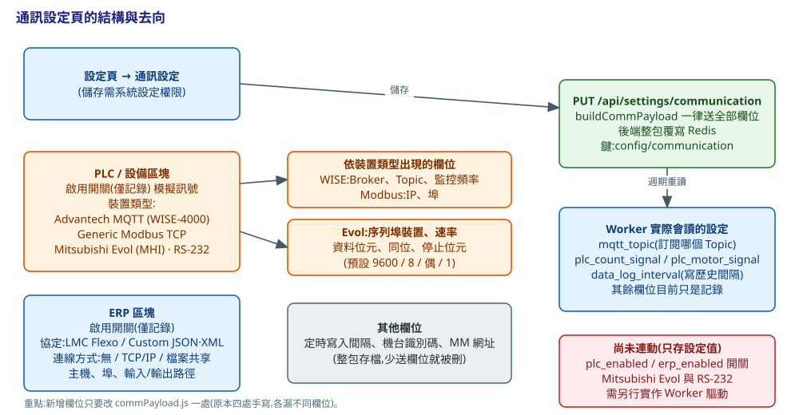

通訊設定分為上下兩個區塊:

**PLC / 設備區塊**(上方,淺藍底)

- **啟用開關**:記錄這個設備通道要不要啟用。**目前只是記錄設定值,尚未連動實際連線**(開關旁有灰字提示)。
- **模擬訊號**:勾選後使用模擬訊號。
- **裝置類型**:
  - **Advantech MQTT (Wise-4000)**:現場主要設備。顯示通訊協定「MQTT · Advantech WISE-4000」,需填 **MQTT Broker URL**、**MQTT Topic**(預設 `Advantech/+/data`)與**監控頻率**。
  - **Generic Modbus TCP**:填 IP 與埠。
  - **Mitsubishi Evol (MHI)**:三菱印刷機。顯示通訊協定「Mitsubishi Evol (MHI) · RS-232」,改填**序列埠裝置**(如 `/dev/ttyUSB0` 或 `COM1`)、**傳輸速率**(預設 9600)、**資料位元**(預設 8)、**同位檢查**(預設偶)、**停止位元**(預設 1)。**此類型目前只儲存設定值,尚無驅動程式實際連線。**
- 「測試連線」「監看訊息」按鈕:僅適用 MQTT / Modbus;選 Evol 時不顯示。

**ERP 區塊**(下方,淺橘底)

- **啟用開關**(同上,僅記錄)。
- **通訊協定**:LMC Flexo 或自訂 JSON/XML。
- **連線方式**:無連線、TCP/IP(填主機與埠)、檔案共享(填輸入/輸出路徑)。

**其他欄位**:**定時寫入間隔**(單位秒,範圍 1~3600,預設 300)、**機台識別碼**、**MM 網址**。

> **⚠ 儲存行為**:通訊設定是**整包儲存**。系統每次都會送出**全部欄位**,避免漏欄位而把原有設定洗掉。

---

## 8. 文件頁

點上方導覽的「**📖 文件**」進入。

- 左側依分類列出文件(操作手冊、設計文件、部署、測試、會議等);右側顯示內容。
- **看得到哪些文件依角色而定**:作業員只看**操作說明書**(中、英兩版);管理者、工程師、主管看全部。
- 文件支援**圖片、表格、流程圖**;點圖片可在新分頁開啟原圖。
- 左上的「操作紀錄」按鈕可看即時操作日誌。

---

## 9. 故障排除

| 現象 | 可能原因 | 處理 |
|---|---|---|
| 按 F3 沒反應,提示 PLC 未連線 | 設備訊號沒進來 | 看狀態列 PLC 是否綠點;檢查現場設備與網路,或請管理者確認通訊設定 |
| 按 F4 提示「車速不為 0」 | 機器還在跑 | 讓機器完全停下再按 |
| 按 F4 提示數量為 0 | 本筆沒有生產數量 | 若訂單要放棄,改按 **F10 退回** |
| 按 F10 提示車速不為 0 | 機器還在跑 | 先停機 |
| 車速一直顯示 0,但機器在跑 | 設備訊號沒進來或後端沒收到 | 看狀態列;通知維護人員檢查 MQTT 與設備 |
| 報表是空的 | 日期區間內沒有資料;或預設是「今天」 | 把日期範圍調到有生產的日期再按「確認」 |
| 報表標示「改以本機計算」 | 有未同步的本機紀錄,或後端暫時連不上 | 用「本機舊實績回填」同步;或稍後重試 |
| 日報與月報的 OEE 不同 | 算法不同(加權平均 vs 合計重算) | 屬設計;稼動率兩者一致 |
| 頁面一片空白 | 瀏覽器快取了舊版網頁 | 強制重新整理(Windows `Ctrl+F5`,Mac `Cmd+Shift+R`) |
| 登入後一段時間被登出 | 權杖與刷新憑證都過期 | 重新登入 |
| F 鍵沒反應 | 不在「即時監控」頁,或焦點在輸入欄 | 回到即時監控頁,點一下空白處再按 |

---

## 10. 附錄

### 10.1 F 鍵速查

| 鍵 | 功能 | 鍵 | 功能 |
|---|---|---|---|
| F1 | 上移 | F7 | 訂單詳情 |
| F2 | 下移 | F8 | 自動/手動下一筆 |
| F3 | 送單(需 PLC 連線) | F9 | 換班別 |
| F4 | 完工(需車速 0、數量 > 0) | F10 | 退回(需車速 0) |
| F5 | 計數 +1 | F12 | 離開 |
| F6 | 計數 −1 | | |

### 10.2 名詞

| 名詞 | 說明 |
|---|---|
| OEE | 整體設備效率 = 稼動率 × 效能 × 良率 |
| 稼動率 | 運轉時間占負荷時間的比例 |
| 工廠日 | 以早上 08:00 換日的生產日期 |
| 冪等鍵 | 每筆完工實績的唯一識別,避免重送時產生重複資料 |
| pending / synced | 完工實績在本機的同步狀態:尚未送達 / 已送達後端 |
| Auto Next | 自動下一筆模式,影響 F10 退回的行為 |
| PLC 連線 | 設備訊號是否有送進系統 |

### 10.3 保養維修與零件管理

**保養維修**與**零件管理**已於 2026-06 移出主系統,改由獨立的 **MM 設備資產管理外掛**提供(本機入口 `http://localhost:5301`)。主系統選單沒有這兩項功能。操作請見 `操作說明文件.html`(v3.0 定稿)的 MM 章節。

### 10.4 系統全貌

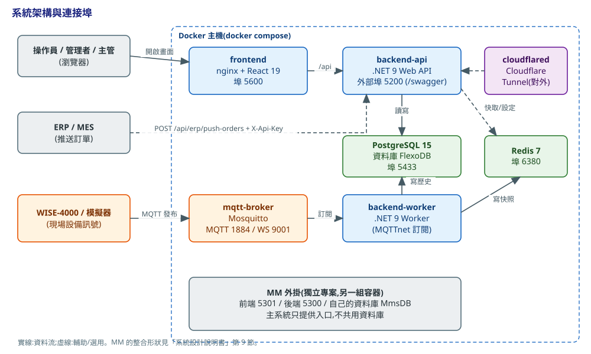
