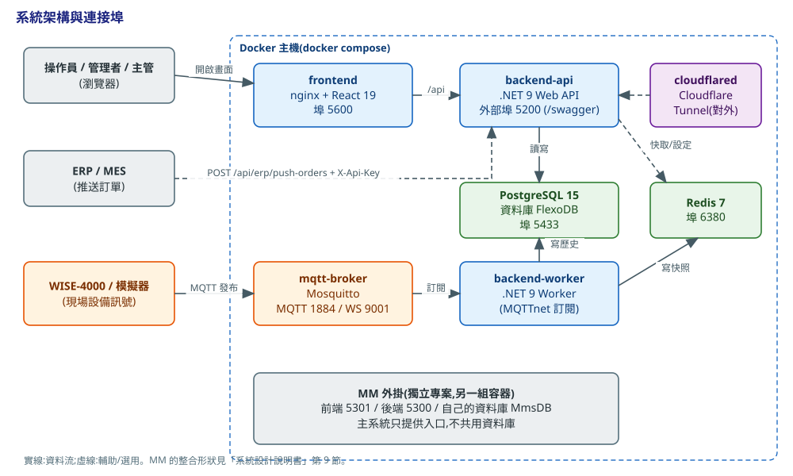
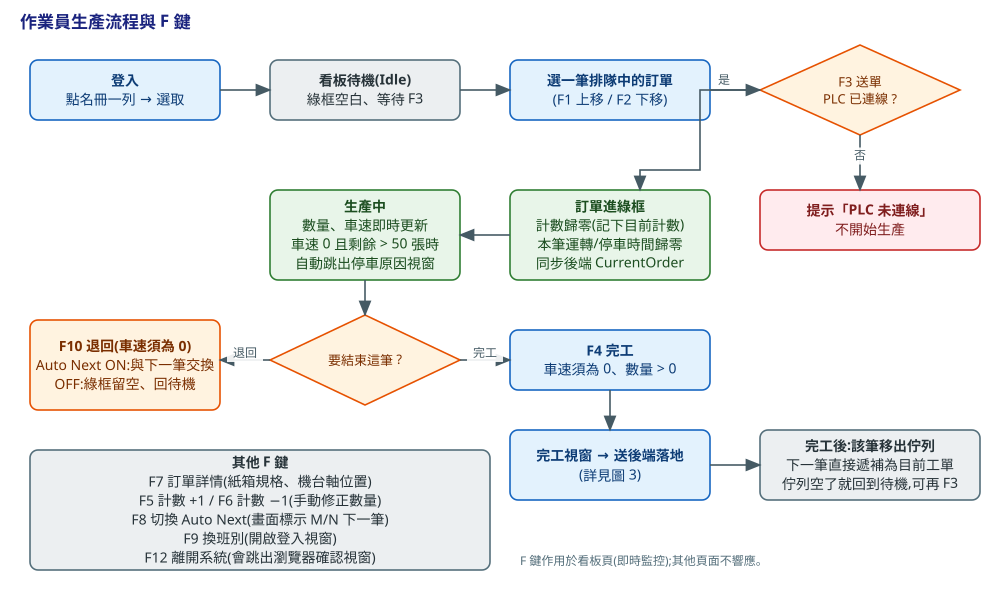
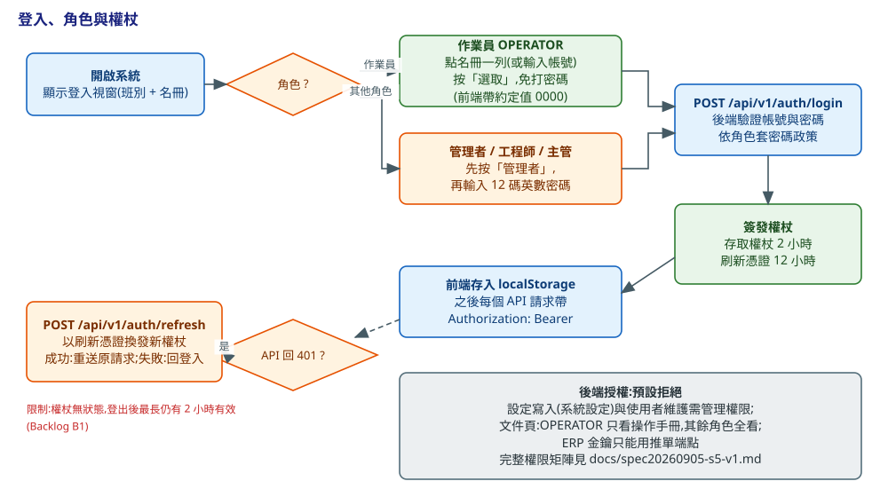
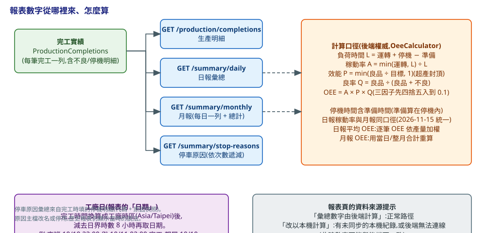
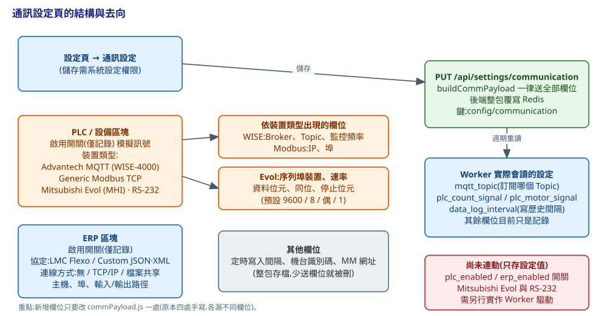

# 印刷 IoT 系統設計說明書(現況版)

> **版本**:2026-11-15。**依現在的程式碼與實機行為撰寫**,每一節都標明依據的檔案或端點。
> **與舊文件的關係**:`開發說明書.md`、`SASD說明書.md`、`MQTT訊息處理流程.md` 是**歷史快照**(正文凍結),其中部分內容已與現況不同(例如完工實績已改走 REST API,見第 5 節);**以本文件為準**。
> **定位**:本專案是以與公司 LT IoT 相同的架構做的**自我測試**系統,不是公司產品的程式來源。
> **配套文件**:`操作說明書.md`(給使用者,含畫面截圖);本文件給開發與維運人員。

---

## 目錄

1. [系統概觀與技術棧](#1-系統概觀與技術棧)
2. [系統架構](#2-系統架構)
3. [資料儲存](#3-資料儲存)
4. [即時資料流](#4-即時資料流)
5. [完工實績](#5-完工實績)
6. [訂單、排程與作業流程](#6-訂單排程與作業流程)
7. [認證與授權](#7-認證與授權)
8. [報表口徑](#8-報表口徑)
9. [通訊設定與外部整合](#9-通訊設定與外部整合)
10. [前端結構](#10-前端結構)
11. [部署與維運](#11-部署與維運)
12. [已知限制與待辦](#12-已知限制與待辦)
13. [測試](#13-測試)
14. [與 MM 外掛的整合與權責原則](#14-與-mm-外掛的整合與權責原則)

---

## 1. 系統概觀與技術棧

**一句話**:針對瓦楞紙箱印刷(柔印)機台的**即時監控與生產管理**系統:接收設備訊號 → 即時顯示 → 作業員完工登錄 → 報表與分析。

| 層 | 技術 |
|---|---|
| 前端 | React 19、Vite 7、Leaflet;測試 vitest;檢查 eslint |
| 後端 | **.NET 9**:API、Worker、Core、Infrastructure、Tests 五個專案 |
| 資料庫 | PostgreSQL 15(單一資料庫 `FlexoDB`)、Redis 7 |
| 訊息 | MQTT(Mosquitto + MQTTnet) |
| 週邊 | MinIO(S3)、Modbus(Pymodbus)、PaddleOCR、Google Gemini、Cloudflare Tunnel |
| 後端測試 | xUnit + Moq + EF Core InMemory + `Mvc.Testing` |

**服務與連接埠**:前端 5600、API 5200(`/swagger`)、Postgres 5433、Redis 6380、MQTT 1884、MQTT WebSocket 9001。

---

## 2. 系統架構

| 元件 | 職責 |
|---|---|
| **frontend** | nginx 提供 React 打包檔;把 `/api/` 反向代理到 backend-api |
| **backend-api** | REST API:認證、訂單、完工實績與彙總、監控快照、設定、原因主檔、產品、ERP 推單 |
| **backend-worker** | 訂閱 MQTT、解析設備訊號、算車速、寫 Redis 快照與歷史、發布監控廣播 |
| **mqtt-broker** | Mosquitto,設備與 Worker 之間的訊息匯流 |
| **postgres / redis** | 資料與快取、設定 |
| **cloudflared** | 對外入口(Cloudflare Tunnel) |
| **MM 外掛** | 保養維修與零件管理,**獨立專案**(前端 5301 / 後端 5300 / 資料庫 `MmsDB`)。主系統只提供入口 |

**MM 的整合形狀**(設計決定):MM 與主系統是**並列掛在同一個訊息來源上、共用 Parameter**,不是由主系統轉手運轉資料。詳見 `docs/spec20260910-1.md`。

---

## 3. 資料儲存

### 3.1 PostgreSQL(`FlexoDB`)

依據:`backend/PrintingIoT.Core/Entities`。

| 實體 | 用途 |
|---|---|
| `ProductionCompletion` | **完工實績主表**,一張工單完工一列。後端是實績的**權威來源** |
| `ProductionDefect` | 實績的不良明細(代碼 + 原因**快照**) |
| `ProductionStop` | 實績的停機明細(代碼 + 原因快照 + 起始時間 + 時長) |
| `ProductionLog` | 設備遙測歷史(設備、時間、累計長度、車速、狀態、來源) |
| `Order` | 工單/排程。狀態:`Pending`、`InProgress`、`Paused`、`Completed`、`Cancelled` |
| `Product` | 產品(紙箱)主檔 |
| `ReasonCode` | 停機 / 不良原因主檔(軟刪除,以 Code + Type 為唯一鍵) |
| `MachineSection` | 機台部位設定 |
| `Auth/*` | 使用者、角色、刷新憑證、ERP API 金鑰 |

**設計要點**

- **快照而非外鍵**:明細的原因以「代碼 + 名稱」快照保存。原因主檔日後改名或停用,**歷史報表仍顯示當時的說法**。
- **實績比工單活得久**:`ProductionCompletion` 刻意不對 `Order` 建導覽屬性(只留 `OrderId` 與冗餘的 `OrderNumber`),工單被刪除不會連鎖刪掉實績。
- **單一資料庫**:舊的拆分資料庫已整併為 `FlexoDB`,不要再假設有多個資料庫。
- **migration 在 API 啟動時自動套用**(`Program.cs` 的 `MigrateWithRetryAsync`),不是可以挑時機的獨立步驟,見第 11 節。

### 3.2 Redis

| 鍵 | 內容 | 寫入者 | 讀取者 |
|---|---|---|---|
| `factory/monitor` | 即時監控快照(camelCase JSON:`deviceId`、`speed`、`di1`、`status`、`timestamp`、`source`) | Worker(每筆覆寫) | API `GET /api/monitor/realtime` |
| `config/communication` | **通訊設定整包 JSON** | API `PUT /api/settings/communication` | API、Worker(週期重讀) |
| 盒型清單 | 盒型主檔 | API | API |

> **快照格式的注意事項**:Worker 以 **camelCase** 寫入,API 讀回時必須**不分大小寫**反序列化。曾因讀取端區分大小寫,導致車速、設備代碼全部落回預設值(B19,2026-11-13 修正)。

---

## 4. 即時資料流

")

依據:`Worker.cs`、`TelemetryPipeline.cs`、`SignalMappingProvider.cs`、`MonitorController.cs`、`useRealtimeData.js`。

1. **訂閱**:Worker 啟動(或重連)後訂閱兩個 topic:模擬器的 `factory/machine/update`,與真機 WISE 的 topic(預設 `Advantech/+/data`,可由通訊設定的 `mqtt_topic` 覆寫)。Worker **每次連線都重讀 Redis 設定**。
2. **解析**:依通訊設定的 `plc_count_signal`(計數訊號)與 `plc_motor_signal`(馬達訊號)把 payload 轉成統一的 `MachineSample`。
3. **統一管線**(真機與模擬器共用):搶**設備鎖** → **算車速**(設備有帶車速就採設備的,否則依計數變化計算)→ 組成 `MonitorData`。
4. **寫快照**:`SET factory/monitor`,每筆都覆寫。
5. **節流寫歷史**:`ProductionLogs` 只在**該設備第一筆**、**狀態與上次不同**、或**距上次寫入達 `data_log_interval`**(預設 300 秒)時才寫。
6. **廣播**:發布到 MQTT `factory/monitor/update`。
7. **前端輪詢**:每 **1 秒** `GET /api/monitor/realtime`;API 讀 Redis 快照,**沒有快照時回 204**(前端視為「無資料」,不更新畫面)。
8. **顯示**:畫面上的「生產數量」= 即時計數(`di1`)− **歸零偏移**。歸零只在前端:**F3 送單時記下目前計數**作為偏移,因此顯示數量從 0 起算。

**Worker 的 MQTT 斷線處理**(B18,2026-11-05):斷線後自動重連並**重新訂閱**;並有「很久沒收到訊息」的沉默警告,避免失聰而不自知。

---

## 5. 完工實績

到實績落地的流程")

依據:`Dashboard.jsx`、`completionRetry.js`、`ProductionController.cs`、`ProductionService.cs`、`OeeCalculator.cs`。

### 5.1 前端:送出與重試

- **前提檢查**:F4 需**車速 = 0**且**本筆數量 > 0**,才開完工視窗。
- 確認後**先寫本機快取**(`productionHistory`,最多保留 1000 筆,`syncState = pending`),再於**背景**送後端;**全程不 await**,現場的換單、計時歸零不等它。
- **重試判準**(`completionRetry.js`):斷網、429、408、401、5xx → 重試;其餘 4xx(400 欄位錯、403 無權限、409 衝突)→ **不重試**(重送一樣的內容只會得到一樣的拒絕)。退避階梯 **2 秒 → 8 秒 → 30 秒**(429 有 `Retry-After` 時以伺服器為準,上限 60 秒)。
- 用盡仍失敗:不阻擋現場、不跳視窗,本機紀錄留 `pending`,由**報表頁的「本機舊實績回填」(S10)**事後補送。兩條保險**互補、都要留著**:當下重試涵蓋不到「關掉分頁、整晚離線」的情況。
- **舊路徑**:`Dashboard.jsx` 完工時,若前端 MQTT 連線存在,**仍會**另外發布一則到 `factory/production/completion`(舊設計遺留);**實績的權威落地是 REST API**,不是這則 MQTT。

### 5.2 後端:`POST /api/production/completions`

請求為 camelCase JSON,主要欄位:`clientRecordId`(冪等鍵,必填)、`orderId`、`orderNumber`、`deviceId`、`operator`、`shift`、`targetQty`、`goodQty`、`prepTimeMinutes`、`runTimeMinutes`、`stopTimeMinutes`、`avgSpeed`、`shortageReason`、`completedAt`、`defects[]`、`stops[]`。

`RecordCompletionAsync` 的順序:

1. **全部驗證**(長度上限、不可為負、明細 ≤ 200 筆)。失敗 → **400 且資料庫零寫入**。
2. **冪等**:以 `clientRecordId` 查既有列。已存在 → **200**,原樣回既有值,**不新增、不更新**。
3. **後端重算**(請求即使帶了計算欄位也一律忽略):`DefectQty` = 不良明細加總、`StopCount` = 停機明細筆數、**工廠日**、**稼動 / 效能 / 良率 / OEE**。
4. **單次 SaveChanges** 寫入主表與明細。
5. 有 `orderId` 時嘗試把工單推進 `Completed`。**失敗只記 log,不回滾實績**(現場資料優先於參照完整性)。
6. 回傳 201 與後端算出的值;前端以此覆寫本機紀錄。

### 5.3 查詢端點

| 端點 | 用途 |
|---|---|
| `GET /api/production/completions` | 依工廠日區間查詢(`from`、`to`、`page`、`pageSize` 上限 500) |
| `GET /api/production/completions/{id}` | 單筆 |
| `GET /api/production/summary/daily` | 日報彙總(可帶 `shift`) |
| `GET /api/production/summary/monthly` | 月報(每日一列 + 總計) |
| `GET /api/production/summary/stop-reasons` | 停機原因彙總(依次數遞減) |

彙總不分頁;區間資料量超過上限(預設 20000 列,`Production:SummaryMaxRows`)→ 400 要求縮小區間,**不回部分結果**。

---

## 6. 訂單、排程與作業流程

依據:`Dashboard.jsx`、`orderQueue.js`、`Schedule.jsx`、`OrdersController.cs`。

- **排程佇列**:`orders` 陣列,隊首即「目前訂單」(綠框)。佇列的陣列變換抽成 `orderQueue.js` 的純函式(`advanceQueueOnFinish`、`promoteSelectedToHead`、`returnCurrentToQueue`、`finishHeadOrder`),side effect(計時、歸零、後端同步)留在 Dashboard。
- **F3 送單**:需 **PLC 連線**(`isPlcConnected`);綠框為 placeholder 時,把選取的訂單提到隊首、記下 `resetOffset`、運轉/停車時間歸零,並呼叫 `setCurrentOrder` 同步後端「目前訂單」。
- **F4 完工**:`finishHeadOrder` 把隊首**移出**佇列(`slice(1)`),下一筆自動遞補;對 GUID 訂單**回寫狀態為 `Completed`**(失敗只 `console.warn`)。這與 Auto Next 無關。
- **F10 退回**:需車速 = 0;依 **Auto Next**:ON → 與次筆**交換**(立即遞補);OFF → 插入 placeholder,綠框留空。同時清除後端「目前訂單」。
- **停車登記**:車速為 0、剩餘 > 50、已有生產量時,自動彈出停車原因視窗,記錄起始時間(`startedAtIso`),完工時隨 `stops[]` 一併送出。
- **排程同步**:訂單以**後端為權威**。`POST /api/orders/sync` 只 upsert 送來的列並刪除 `deleteIds` 明列的列,**清單外的既有排程一律保留**(不再全量鏡像刪除)。**完工單不從後端刪除**(它是生產紀錄),改回寫狀態;載入端以 `isSchedulableBackendOrder` 過濾,避免完工單下次開頁以「執行中」回到佇列。
- **產品庫**目前仍是 **localStorage-only**,只有訂單遷到後端。

---

## 7. 認證與授權

依據:`AuthController.cs`、`authStorage.js`、`api.js` 攔截器、`docRegistry.js`。

- **端點**:`POST /api/v1/auth/login`、`/refresh`、`/logout`(皆匿名可呼叫);其餘預設需授權。
- **角色**:`ADMIN`、`ENGINEER`、`SUPERVISOR`、`OPERATOR`。後端**預設拒絕**;授權以 Policy 控制(例:使用者維護 `UserAdmin`、系統設定寫入 `SystemConfig`)。完整矩陣見 `docs/spec20260905-s5-v1.md`。
- **權杖**:存取權杖 **2 小時**、刷新憑證 **12 小時**(`Auth:RefreshTokenHours`)。前端攔截器遇 401 先以刷新憑證換發並重送;換發失敗才登出。
- **密碼政策依角色分流**:`OPERATOR` 可用 4 碼純數字;`ADMIN` / `ENGINEER` / `SUPERVISOR` 為 12 碼英數。前端登入畫面對作業員帶約定值,所以作業員「點名冊一列 + 選取」即登入。
- **帳號不分大小寫**(以 `UsernameNormalized` 唯一索引背書)。
- **ERP 對機器憑證**:`X-Api-Key` 標頭,由 ADMIN 於 `/api/v1/apikeys` 建立,**明文只在建立當下回傳一次**,撤銷不刪列。金鑰**只對推單端點有效**(`POST /api/erp/push-orders`),打不開其他端點。
- **文件頁分權**:`docRegistry.js` 的 `canRead`——OPERATOR 只看操作說明書(中英兩版),其餘角色全看;**未登入或無角色一律看不到**。權限在 `loadDoc` 再擋一次,不只靠側欄不畫出來。注意文件內容是靜態資源,能載入前端的人技術上可直接取得(已知並接受)。
- **限制**:權杖無狀態,登出或停用後已發出的權杖最長仍有 2 小時有效(Backlog B1)。

---

## 8. 報表口徑

依據:`OeeCalculator.cs`(權威)、`ProductionService.cs`、`reportUtils.js`(前端孿生)、`FactoryDayCalculator.cs`。

### 8.1 OEE 規則(§5.1,`docs/spec20260903-s3-v1.md`)

| 規則 | 公式 |
|---|---|
| 負荷時間 L | `max(0, 運轉 + 停機 − 準備)` |
| 稼動率 A | `min(運轉, L) ÷ L × 100`(L ≤ 0 → 0) |
| 效能 P | `min(良品 ÷ 目標, 1) × 100`(目標 ≤ 0 → 0)。**分子用良品數**(客戶指定口徑) |
| 良率 Q | `良品 ÷ (良品 + 不良) × 100` |
| OEE | `A × P × Q ÷ 10000`,以**已四捨五入到 0.1 的三因子**相乘 |

- **「停機時間」含準備時間**(準備算在停機裡),所以負荷時間要扣掉準備。
- 效能分子用良品、良率也用良品,使良品在 OEE 中被計入兩次,OEE 略為保守。這是**客戶明確指定的口徑**,不是疏漏;若改回「總產出 ÷ 目標」,**C# 與 JS 兩處實作與測試都要同步改**。
- 分母為零一律回 0,不以 1 假裝滿分。
- C# 與 JS 以**共用黃金向量**測試釘住相同數值,且特別放在 **x.x5 邊界**(decimal 與二進位浮點正是在那裡分岔)。

### 8.2 彙總

| 彙總 | 稼動率 | OEE |
|---|---|---|
| 日報 `/summary/daily` | 與月報**同口徑**(扣準備;2026-11-15 統一) | **逐筆 OEE 依產量加權平均**(規則 6) |
| 月報 `/summary/monthly` | 以當日/整月合計重算(扣準備) | 以合計重算 |

> 日報的「平均 OEE」與月報的 OEE **口徑不同**(先平均 vs 先加總),數字可能不同;稼動率則一致。

### 8.3 工廠日

`FactoryDayCalculator.Resolve`:完工時間(UTC)→ 轉成工廠時區(`Factory:TimeZone`,預設 `Asia/Taipei`)→ **減去日界時數**(`Factory:DayBoundaryHour`,預設 8)→ 取日期。例:夜班 10/10 22:00 與 10/11 02:00 完工的單,工廠日都是 10/10。

---

## 9. 通訊設定與外部整合

依據:`CommunicationTab.jsx`、`commPayload.js`、`SettingsController.cs`、`SettingsService.cs`、`SignalMappingProvider.cs`。

- **儲存**:`PUT /api/settings/communication`(需 `SystemConfig` 政策),後端**整包覆寫** Redis `config/communication`,**送什麼存什麼、沒送的鍵直接消失**。因此前端 `buildCommPayload` **一律送出全部欄位**。曾因四處手寫 payload 各漏不同欄位,導致「按一次儲存就洗掉監控頻率與 MQTT 設定」;現已收斂成單一函式,**新增欄位只要改一處**,並有測試釘住。
- **PLC / 設備區塊**的裝置類型:`wise`(Advantech MQTT)、`modbus`、`mhi_evol`(Mitsubishi Evol,RS-232;欄位 `plc_serial_port`、`plc_baud_rate`、`plc_data_bits`、`plc_parity`、`plc_stop_bits`,預設 9600 / 8 / 偶 / 1)。
- **ERP 區塊**:`erp_protocol`(`lmc_flexo`、`custom`)、`erp_connection_type`(`none` / `tcp` / `file`)、主機、埠、輸入/輸出路徑。
- **Worker 實際會讀的只有**:`mqtt_topic`、`plc_count_signal`、`plc_motor_signal`、`data_log_interval`。
- **尚未連動(只存設定值)**:`plc_enabled`、`erp_enabled` 開關;`mhi_evol` 與 RS-232。Worker 沒有 Evol 協定驅動,也沒有序列埠存取;若要實作,Docker 還需把序列埠裝置掛進容器。
- **ERP 推單**:管道已建好(`X-Api-Key`),但**尚未串接**;`ApiKeys` 為空表時系統一切正常,只是 ERP 推單不可用。

---

## 10. 前端結構

| 區塊 | 位置 | 說明 |
|---|---|---|
| 路由 | `App.jsx` | `/`(監控)、`schedule`、`reports`、`analysis`、`settings`、`docs`,另有 `/debug` |
| 頁面 | `pages/` | `Dashboard`、`Schedule`、`DocsPortal`、`DebugDashboard` 等;報表/分析/設定以延遲載入 |
| Hooks | `hooks/` | `useRealtimeData`(輪詢)、`useReasonCodes`、`useProductionRecords`、`useProductionSummary`、`useBackfill`、`useTransientNotice` 等 |
| 純函式 | `utils/` | `orderQueue`、`completionRetry`、`reportUtils`、`commPayload`、`factoryDate`、`backfillMapper`、`scheduleDnd`、`dataLogInterval` 等 |
| 設定頁分頁 | `components/settings/` | `GeneralTab`、`UnitTab`、`MachineTab`、`FormulaTab`、`CommunicationTab`、`BoxTypeTab`、`ReportTab` |
| 多語系 | `modules/language/` | 繁中、簡中、英、越、泰五語;`localeParity` 測試確保各語系鍵一致 |
| **文件頁** | `modules/docs/`、`pages/DocsPortal.jsx` | 見下 |

**文件頁的設計**(S14 + 2026-11-15 圖文化)

- **不經 API**:建置時以 `import.meta.glob` 把 `doc/*.md` 收進前端,頁面不發任何請求;每份文件是獨立 chunk,點了才載入。清單由**實際存在的檔案**產生,不再手寫(手寫清單曾列出不存在的檔)。
- **圖片**:`doc/pic/**` 的圖檔在建置時收進前端(`resolveDocImage`)。**只認 `doc/pic` 內的檔案,不載入外部圖片**;路徑含 `..` 或為外部網址一律不放行。
- **渲染器**(`markdownRender.jsx` + `markdownParse.js`):自寫、**無新相依**,輸出 React 元素。支援標題、段落、引用、有序/無序清單(可巢狀)、表格、程式碼區塊、分隔線、圖片、連結、粗體/斜體/行內程式碼。**文件內的 HTML 一律當純文字**,`javascript:` 連結不產生 `<a>`。
- **流程圖**:不支援 mermaid;改用 SVG 圖檔,由 `scripts/gen-doc-diagrams.py` 產生到 `doc/pic/flow/`。**改圖請改這支腳本再重跑**,不要手改 SVG。
- **注意**:`doc/` 底下的 Markdown **會出現在產品畫面上**;`docs/` 才是不對外的 report / spec。

---

## 11. 部署與維運

依據:`docker-compose.yml`、`frontend/nginx.conf`、`docs/report20260906-2.md`。

- **啟動全套**:`cp .env.example .env`(`JWT_SECRET` 必填)後 `docker compose up -d --build`。
- **migration 是 API 啟動時自動套用的**。所有 DBA 前置檢查必須在 `docker compose up --build` **之前**跑完;真撞上必然失敗的 migration 時,會重試 10 次,加上 `restart: always` 變成無限重啟,現場只看到「API 一直起不來」。
- **前端改完要重建容器才會上線**:compose 服務的是打包後的檔案,不是原始碼。`docker compose up -d --build frontend` 會**連帶重建 backend-api**(相依關係);只要單一服務可加 `--no-deps`。
- **前端快取**:`index.html` 回應 `Cache-Control: no-cache`;`/assets/` 為帶雜湊檔名的長期快取,**不存在的資產回 404**(不再回退成 `index.html`)。這是 2026-11-15 為避免「部署後使用者拿到舊 `index.html` → 指向已被換掉的 JS → 整頁空白」所做的設定。
- **限流**:額度由設備數推導——`RateLimit:MaxDevices`(預設 5)× 120 = 全域 600 次/分。走 Cloudflare Tunnel 或 Docker 埠轉發時所有來源會被 NAT 成同一位址,**限流分區等於全廠共用一個桶**。**現場加機台只要改 `MaxDevices` 這一個數字**。
- **大小寫**:Mac 檔案系統不分大小寫、Linux 容器分,import 路徑大小寫必須完全一致,否則「本機過、進 Docker 炸」。
- **macOS `._*` 檔會弄壞 `dotnet build`**:`find . -name "._*" -delete`。
- **回滾**:部署前先留回滾點(映像標籤或 git tag + 資料庫備份)。

---

## 12. 已知限制與待辦

| # | 事項 |
|---|---|
| B1 | 存取權杖無法撤銷(JWT 無狀態,登出後最長仍有 2 小時) |
| B2 | 金鑰管理沒有前端 UI(走 curl / Swagger) |
| B3 | 名冊快取是單機的 |
| B5 | 回填面板只在報表頁 |
| B12–B14 | 後端 `DocsController` 已成死碼;文件內容為公開靜態資源;`doc/pic` 圖片現已收進建置(B14 已解),但 `操作說明文件.html` 仍不在文件頁範圍 |
| B20 | 其他頁面仍有約 50 個 `alert` / `confirm`(排程「順序重置」、F12 離開等) |
| i18n | 設定頁、各視窗、文件仍有約 340 字串硬編碼 |
| 連動 | 通訊設定的啟用開關、Mitsubishi Evol 與 RS-232 **尚未連動實際連線** |
| 其他 | 日報平均 OEE 與月報 OEE 口徑不同(設計如此);狀態列「Start Time」為固定的版面文字 |

詳細清單與出處見專案根的 `handoff.md`。

---

## 13. 測試

| 項目 | 指令 | 2026-11-15 結果 |
|---|---|---|
| 後端 | `dotnet test backend/PrintingIoT.sln` | 363 通過 |
| 前端 | `cd frontend && npm run test`(vitest) | 503 通過 |
| 檢查 | `cd frontend && npm run lint` | 有既有的未使用變數錯誤(非本次引入) |

> **本機注意**:沙箱內 `dotnet` 指令會假失敗(卡滿 5 分鐘後回報建置失敗),需在沙箱外執行。
>
> **DoD**:新功能附測試且通過;跑過一次真實情境,不是只有單元測試綠燈。

---

## 14. 與 MM 外掛的整合與權責原則

> **狀態:原則已與 MM 雙邊定稿(2026-11-16,Eric 決定);尚未實作。** MM 是獨立的設備保養外掛(另有自己的設計文件,內容與本節一致)。本節只寫原則,不含金鑰與內網位址。

**前提**:MM 與本系統**真分離**,無程式碼相依,只共用「契約」。MM 是**選項**:不啟用時兩邊互不影響。啟用「整合模式」時,**權責管理一律以本系統(PRIIOT)為標準**。

### 14.1 身分與角色

1. **本系統是唯一身分權威。** 整合模式下 MM 不自管人員帳號與密碼,沿用本系統的帳號與角色;MM 的「獨立模式」(沒有本系統)保留自己的帳號。兩種模式二選一,不得同時生效。
2. **角色詞彙沿用四角色**(`ADMIN` / `ENGINEER` / `SUPERVISOR` / `OPERATOR`),**不為 MM 新增角色**。MM 需要的細項權限存在 MM 端,以本系統使用者的**不可變 id** 為鍵。
3. **MM 功能對應角色**:

| 本系統角色 | MM 可做的事 |
|---|---|
| `ADMIN` | 全部,含圖資管理 |
| `SUPERVISOR` | 管理動作,不含系統設定與使用者管理 |
| `ENGINEER` | 建立紀錄、上傳、BOM 編輯 |
| `OPERATOR` | 檢視與報修 |

   圖資管理僅 `ADMIN`;MM 後端須補上這項把關(原本只有前端隱藏頁籤)。
4. **不留本機緊急管理員。** 與本系統「不留免硬體後門」一致;本系統掛掉時,已登入的 MM 工作階段撐到快取到期,需要完全獨立就用 MM 獨立模式。
5. **第二因素由本系統負責。** 本系統目前沒有第二因素;MM 自己的 WebAuthn 只在獨立模式保留,整合模式關閉。

### 14.2 登入與權杖驗證

- 本系統的登入權杖是**共用金鑰簽章(HS256)**,簽章金鑰**不分享給 MM**。
- 本系統將提供**驗證端點**(introspection / userinfo):回傳使用者 id、顯示名、角色、啟用狀態。MM 呼叫它,並**短時快取(建議 30–60 秒,數值寫入契約)**。
- 驗證端點失敗時:**新登入一律拒絕**,已快取的工作階段撐到快取到期為止。
- 帳號在本系統停用後,MM 側最晚在快取到期時失效。
- **跨網域登入**(瀏覽器端不可把權杖放在網址上):採**一次性短效代碼換票**——使用者先在本系統登入,本系統發出綁定 MM、單次有效、約 1 分鐘到期的代碼,MM 後端以機器金鑰向本系統兌換使用者資訊後建立自己的工作階段。不依賴兩邊同網域。

### 14.3 機器對機器

- MM 讀本系統一律用 `X-Api-Key`,新增機器身分 **`MM_SERVICE`**:與 `ERP_SERVICE` 同規格——不可指派給人、不列入角色表、**唯讀**、可撤銷、可到期、只能打白名單端點。金鑰由本系統 `ADMIN` 建立。
- **並列來源原則不變**:運轉量以 MM 並列訂閱同一訊號來源(MQTT / WISE / Modbus)為主;本系統 API 只是第三個選項(MM 另有人工輸入與計數器兩種)。**本系統不可用時,MM 退回人工輸入而非停擺;MM 離線不得影響本系統。**
- 規劃的唯讀端點(契約待定稿):使用者驗證、設備代號清單、每台設備的計數(單調累計值,或明確的歸零事件)、狀態轉換事件(故障起訖)、健康檢查。MM 目前一個實例只管一台設備,設備代號一對一,契約不需為多設備批次最佳化。
- **故障只作為維修依據的提示**,是否建立維修單由 MM 使用者決定,**不自動建單**。目前只有狀態值(`Error` / `Maintenance`),**沒有故障碼**;故障碼待 PLC 暫存器確認。

### 14.4 資料權責與稽核

| 資料 | 歸屬 |
|---|---|
| 計數、運轉狀態、故障訊號(事實) | 本系統提供,MM 唯讀 |
| 保養紀錄、維修單、備品零件 | MM 擁有,本系統不存 |
| 設備代號對照表(MM 設備 ↔ 本系統 `deviceId`) | MM 維護,不寫回本系統 |

- MM 的操作紀錄記**本系統使用者的不可變 id**,另存**顯示名快照**(顯示名會改)。
- 時區沿用 `Asia/Taipei`。MM 既有紀錄綁本地帳號字串,切換整合模式時需要遷移對映(細節待 MM 確認)。

### 14.5 契約與實作順序

- 路徑 `/api/v1/…`;契約須含**版本號、錯誤碼、`since` 游標語意、計數是否單調**;雙邊各存一份且一致。
- 順序:① 本節與契約定稿 → ② 本系統做驗證端點、`MM_SERVICE` 與唯讀端點 → ③ MM 在 v2 內加「整合模式」開關(預設關,獨立模式不動)。
