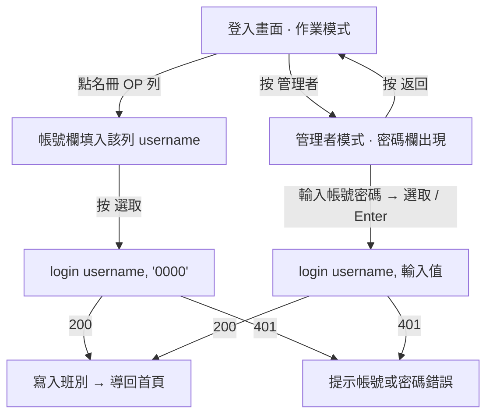

# spec20260915-1 — S17 登入畫面:管理者才要密碼、作業員一鍵登入、名冊內聯新增

> 2026-09-15 · 對應 S16 revert(`c99b8b4`)之後的登入畫面現況
> 需求來源:Eric 手繪標註(標記 1 / 2 / 3 / 4 與 a / b)+ 本次對話兩項決策

---

## 1. 現況與問題(查證過)

還原 S16 之後,登入畫面(`frontend/src/modules/auth/LoginModal.jsx`,`:5600` 實機截圖確認)長這樣:

| 區塊 | 內容 |
|---|---|
| 頂列 | 管理者 (Admin) / 選取 (Select) / 離開 (Exit) |
| infoBar | 當前班別下拉、帳號欄、**密碼欄(永遠顯示)** |
| rosterEditor | 代碼 / 班別 / 操作員 三個編輯欄(在名冊表正上方) |
| 名冊表 | 代碼 / 班別 / 操作員 三欄 + 右側「新增」「刪除」 |
| 班別時段表 | 開始 / 結束 / 人數 + 右側「刪除」 |
| 頁尾 | 時 : 分 ~ 時 : 分、人數、新增時段、自訂時段 |
| adminOverlay | 按「管理者」跳出的子視窗,欄位與主畫面**同一組 state、同一個 `handleLogin`** |

**問題一:作業員登入要做的事太多。** 現場 OP 換班登入一次:選班別 → 點名冊列 → 打密碼 → 按選取。
其中密碼是唯一真正的驗證,其餘都是重複點選(`resolveShiftCode()` 本來就是名冊列的班別優先、下拉只是退路)。

**問題二:密碼欄對作業員而言是純阻礙。** 現場觸控機台沒有實體鍵盤,12 碼英數密碼在看板前輸入不現實。

**問題三:名冊新增的動線繞。** 要新增一列得先在表格**上方**的三個編輯欄填好,再按表格**右側**的「新增」。
編輯欄與表格列的對應關係只能靠猜(手繪圖上那三條橘色箭頭畫的就是這件事)。

**擋路的兩個既有事實**(本次查證,非推測):

1. `AuthController.cs:514 ValidatePassword()` —— 密碼須 **≥ `Auth:MinPasswordLength`(`appsettings.json:32` 實際值 12)且必含至少一個字母與一個數字**。
   `0000` 兩條都不過,現況**建不出來也改不進去**。
2. `POST /api/v1/auth/users` 掛 `[Authorize(Policy = UserAdmin)]`(`AuthController.cs:333-335`),
   **建帳號一定要 ADMIN 權杖**。登入畫面在未登入狀態下不可能建後端帳號。
3. `POST /api/v1/auth/login` 是 `[AllowAnonymous]` + `EnableRateLimiting("auth")`,
   額度 `RateLimit:Auth:PerDevicePermitLimit` = **5 次 / 分鐘 / 分區**(分區實際是整廠共用,見 `report20260907-1.md`)。

---

## 2. 目標

做完之後:

- 作業員換班登入 = **點名冊一列 → 按「選取」**,全程不碰密碼欄,兩個動作。
- 管理者登入 = **按「管理者」→ 密碼欄才出現 → 輸入 → 登入**,畫面平時看不到密碼欄。
- 名冊新增 = 表格最後一列一個 `+`,按下去**就地多一行空白列**,直接在列上填代碼 / 班別 / 操作員。
- 管理者那條線的密碼強度**完全不變**(仍是 12 碼英數)。

---

## 3. 設計

### 3.1 兩種模式,一個登入路徑

登入畫面分「作業模式」(預設)與「管理者模式」(按標記 **1** 進入):

| | 作業模式(預設) | 管理者模式 |
|---|---|---|
| 密碼欄 | **不渲染** | 渲染,空白,自動聚焦 |
| 帳號欄 | 渲染(點名冊列自動填) | 渲染 |
| 送出 | 「選取」→ 帶 `0000` 呼叫 `login()` | 「選取」/ Enter → 帶輸入值呼叫 `login()` |
| 名冊區 | 可點選、可新增 / 刪除列 | 同左 |

**為什麼不是做兩條登入邏輯:** 現況已經只有一個 `handleLogin()`,S16 移除 `adminOverlay` 的理由(同 state、同 handler,是純重複)仍然成立。
這次只讓**密碼的來源**分流(常數 vs 使用者輸入),驗證路徑仍然只有 `POST /api/v1/auth/login` 一條。

**沒選 `adminOverlay` 子視窗:** 手繪圖標記 1→3 的箭頭是「按管理者,密碼欄亮出來」,不是「跳一個視窗」。
子視窗在觸控機台上還多一層關閉動作,而且它和主畫面共用 state 本來就沒有隔離意義。**adminOverlay 本次移除。**

### 3.2 作業員預設密碼 `0000`

- 前端常數 `DEFAULT_OPERATOR_PASSWORD = '0000'`,作業模式送出時使用。
  **刻意放在原始碼、不放 localStorage** —— 它不是秘密,是一個約定值,存起來只會多一個會漂掉的副本。
- 密碼欄的 markup、樣式、i18n 字串**全部保留**(只是作業模式不渲染)。
  這是「以後要開作業員密碼」的回頭路:把 `showPassword` 的條件改掉就回來了,不必重寫版面。

### 3.3 後端密碼政策依角色分流(本次決策)

`ValidatePassword` 改成接受角色參數:

| 角色 | 最短長度 | 字元要求 | 設定鍵 |
|---|---|---|---|
| OPERATOR | 4 | 無(允許純數字) | `Auth:OperatorMinPasswordLength`(新增,預設 4) |
| ADMIN / ENGINEER / SUPERVISOR | 12 | 至少一字母 + 一數字 | `Auth:MinPasswordLength`(不動,12) |

兩個呼叫點都要改:
- `CreateUser`(`:333`)—— 角色來自 request,直接用。
- `UpdateUser`(`:403`)—— **角色可能同時被這次請求改掉**,判準取「這次請求後的角色」而非舊角色,
  否則「把 OPERATOR 升成 ADMIN 並同時設 4 碼密碼」會漏網。

**沒選全域降到 4 碼:** admin 那條線是整個系統唯一的管理入口,
而且 `eric4577599` 那組舊密碼外洩的教訓還在(見 `handoff.md` 置頂)。

**沒選免密碼登入端點:** 要另寫端點 + 授權矩陣測試,而且前端連密碼欄都沒得保留,
與「先保留欄位與 UI」的要求相反。

### 3.4 名冊內聯新增(標記 a / b)

- 名冊表最後固定一列 `+`(整列可點),按下去在 `users` 尾端 append 一筆空白列並進入編輯狀態。
- 列上三格改為可就地編輯(代碼 / 班別 / 操作員),取代表格上方那排 `rosterEditor` 編輯欄。
- 右側「新增」按鈕(標記 b)**保留**但語意收斂成「儲存目前這列」;「刪除」不動。
- **語意不變:名冊仍只是這台機器的 localStorage 觸控快捷清單**(本次決策:`+` 不建後端帳號)。
  畫面下方 `login.hint.rosterLocal` 那行提示**必須留著**,而且要在空白列出現時也看得到 ——
  現場最容易誤會的就是「我在這裡加了人,他就能登入了」。實際上新人要能登入,
  仍須管理者以 ADMIN 身分呼叫 `POST /api/v1/auth/users` 建帳號。

**`confirm()` 保留但標記:** `handleDeleteUser` 目前用 `confirm()`。不在本次範圍,
但要記得**瀏覽器擴充功能會被它卡死**(見 `handoff.md`),自動化驗收時不得點該按鈕。

### 3.5 流程



---

## 4. 分階段

| 階段 | 內容 | 風險 | 可逆性 |
|---|---|---|---|
| **P1** | 後端密碼政策依角色分流 + xUnit 測試 | 低 —— 只放寬 OPERATOR,既有帳號不受影響 | 改回單一 `ValidatePassword` 即可 |
| **P2** | 既有 OP1~OP5 密碼改為 `0000`(ADMIN 呼叫 `PUT /api/v1/auth/users/{id}`) | **中 —— 動線上帳號**,要在沒人使用時做 | 重設回原密碼即可,但原密碼在 `.credentials-20260906.txt` |
| **P3** | 前端兩模式 + 密碼欄條件渲染 + `DEFAULT_OPERATOR_PASSWORD` | 低 | revert 單一 commit |
| **P4** | 名冊內聯 `+` 新增列,移除 `rosterEditor` 那排欄位 | 低 —— 純本機 localStorage | 同上 |
| **P5** | 重建前端容器上線 | 中 —— **連帶重建 backend-api**,線上有人時要挑時間 | 回上一個 image |

P1 必須在 P2 之前(政策沒放寬,`0000` 改不進去)。P3 必須在 P2 之後(帳號密碼還不是 `0000` 時,一鍵登入會 401)。

---

## 5. 驗收

### AC(後端)

| # | 判準 |
|---|---|
| AC-01 | ADMIN 建 OPERATOR 帳號、密碼 `0000` → 201 |
| AC-02 | ADMIN 建 ADMIN 帳號、密碼 `0000` → 400,訊息指出 12 碼 |
| AC-03 | ADMIN 建 OPERATOR 帳號、密碼 `000` → 400(低於 4 碼) |
| AC-04 | `PUT users/{id}` 把既有 OPERATOR 密碼改 `0000` → 204 |
| AC-05 | `PUT users/{id}` 同時把 OPERATOR 升成 ADMIN 且密碼 `0000` → 400(取**這次請求後**的角色) |
| AC-06 | ADMIN 既有帳號改 11 碼密碼 → 400(既有強度未被削弱) |
| AC-07 | `POST login` 帶 `OP1` / `0000` → 200,角色 `OPERATOR` |

### AC(前端)

| # | 判準 |
|---|---|
| AC-08 | 初始渲染:查無密碼欄(`queryByLabelText('密碼')` 為 null) |
| AC-09 | 按「管理者」→ 密碼欄出現且為空;按「返回」→ 密碼欄消失且值被清掉 |
| AC-10 | 作業模式點名冊 OP 列 → 按「選取」→ `login` 被以 `('OP1', '0000')` 呼叫 |
| AC-11 | 管理者模式輸入 `admin` + 密碼 → `login` 被以輸入值呼叫,**不是** `0000` |
| AC-12 | S13 釘樁仍成立:使用者自己打的帳號不被名冊列覆寫,並顯示保留提示 |
| AC-13 | 按 `+` → 名冊表多一行空白可編輯列,填完按「新增」寫進 localStorage |
| AC-14 | `login.hint.rosterLocal` 提示在有空白列時仍可見 |
| AC-15 | 五語系皆無漏字串(新增鍵 `btn.back` 等) |

### 指令

```bash
cd backend && dotnet test PrintingIoT.sln        # 需 dangerouslyDisableSandbox
cd frontend && npm run test && npm run lint && npm run build
docker compose up -d --build frontend            # 連帶重建 backend-api
```

基準線:`dotnet test` 344(S11 當時)、`npm test` 446 passed / 1 skipped、lint 48 errors / 18 warnings、
唯一失敗 `frontend/tests/dashboard.e2e.test.js`(需真實瀏覽器,既有問題)。

### 實機

登入畫面 → 點 OP1 列 → 按「選取」→ 進得去且右上顯示 OPERATOR;
回登入畫面 → 按「管理者」→ 密碼欄出現 → admin 登入 → 進得去且看得到設定頁。

---

## 6. 風險與未決

**已確認的取捨**

1. **`0000` 是公開常數,等於現場作業員帳號無實質認證。** 任何能連到 `:5600` 的人都能以 OPERATOR 身分登入。
   接受這件事的前提是 **OPERATOR 權限僅限現場操作**(看板、排程狀態、報工),
   且對外入口仍在 Cloudflare Tunnel 之後。**若哪天對外開放,這條要先收回。**
2. 登入額度 5 次 / 分鐘 / 分區,而分區實際是整廠共用一個桶。
   一鍵登入會讓誤觸「選取」變得容易,**換班尖峰時多人連點有機會撞到 429**。
   現況前端對 429 靜默(backlog B4),使用者只會看到「沒反應」。**建議 P3 一併補一行提示。**

**未驗證**

3. OP1~OP5 現行密碼是 `.credentials-20260906.txt` 裡那組,**本次未實際登入驗證**(Claude 不得輸入密碼)。
   P2 若發現改不動,先確認帳號本身是否仍 `IsActive`。
4. 名冊列的 `shift` 欄(A / B)與班別時段表沒有連動(backlog B11),本次不處理;
   內聯編輯後這個落差會更明顯,因為兩者會出現在同一張表上。

**不在本次範圍**

5. 班別下拉、班別時段表、頁尾時段控制列**維持現狀不動** —— 手繪圖沒有標註它們。
   S16 曾把這些收進管理者模式,已 revert;要不要再收是另一個決定。
